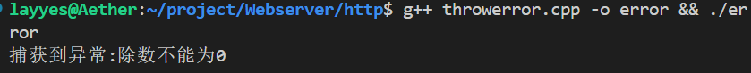

# 异步任务

之前在进行一个并行计算前，为了拿到子线程计算结果，我们需要：
- 声明 `sum` 变量
- 使用 `std::ref` 把引用传给子线程
- 调用 `join()` 挂起主线程
- 再去读取 `sum`
现在有了异步，就非常简单：
```cpp
#include <iostream>
#include <future> // 引入头文件

int add(int a, int b) {
    return a + b;
}

int main() {
    // 启动异步任务：在后台线程跑 add(10, 20)
    std::future<int> result = std::async(add, 10, 20);

    // .get() 会自动等待线程计算完成，并直接拿到返回值！
    std::cout << "计算结果：" << result.get() << std::endl; 
    
    return 0;
}
```

不需要手动创建`std::thread`，也不需要`std::ref`，就能直接拿到后台线程的返回值。

## `std::future`和`std::async`

当我们调用 `std::async(add, 10, 20)` 时，后台会立刻启动一个新线程去计算 `add(10, 20)`。
但是，**计算是需要时间的**！在函数刚调用的那一瞬间，结果其实**还没有算出来**：
- **`std::future`** 就像是后台线程开给你的 **“兑换券”**（或者是预售凭证）
- **`<int>`** 则是告诉编译器：“凭这张兑换券，未来（future）你可以兑换出一个 **`int` 类型** 的返回值。”

也就是说它代表的是一个**未来才会得到的值**。

如果想得到这个值还需要使用`get`函数，因为此时拿到的只是兑换券，而不是真正想要的东西。
假如定义了这么一个任务：
```cpp
std::future<int> result = std::async(add, 1, 2);
```
我们知道结果应该是`3`，要拿到这个数字需要`result.get()`：
- **如果后台已经算好了** 结果，`get()` 会**立刻**把计算好的值拿到手
- **如果后台还在埋头苦算**，`get()` 会让主线程**暂停等待** ，直到后台线程算完并把结果递交过来

## `std::async`的启动策略
如果有这么一行代码：
```cpp
std::future<int> result = std::async(std::launch::async, mission);
```
那么`std::async`中第一个参数又是干什么的？其实是用来告诉系统如何启动这个异步任务：
- `std::launch::async`：异步策略。直接创建一个新的线程（或使用线程池）立即在后台执行任务
- `std::launch::dererred`：延迟策略。不是立即创建新线程，任务会拖延，一直到调用`.get()`函数（怎么感觉有点像自己），才会在当前线程中同步执行

在上面我们使用的是：
```cpp
std::future<int> result = std::async(add, 1, 2);
```
不给它传这个参数的话，系统就会自己根据当前的CPU情况自动选择，但是：**最好显示指定**，因为如果在后面使用了`future.wait_for()`来超时等待任务，但是系统又刚好选择了`deferred`策略，那这个任务永远不会开始，`wait_for`会一直超时返回。

## 超时等待
上面提到了`future.wait_for()`，这就是所谓**超时等待**了。
在多线程开发中后台任务有可能会处理很久（甚至因为某些原因卡住）。直接使用`.get()`的话，主线程就会一直无脑地死等下去，为了避免程序卡死，就可以使用`future.wait_for()`设定一个**最长等待时间**，超过这个时间就不等了。

### `wait_for`三种状态

使用`result.wait_for(时长)`时，会返回一个状态枚举值，告诉我们后台任务进展如何：

- **`std::future_status::ready`** 🎉： 任务已经**算完了**！此时可以安全地调用 `.get()` 瞬间拿到结果。
- **`std::future_status::timeout`** ⏰： **超时了**！到了设定的时间，任务还没有算完。
- **`std::future_status::deferred`** 💤： 任务被设置为了**延迟执行**（比如使用了 `std::launch::deferred` 策略），根本还没开始跑呢。

```cpp
#include <iostream>
#include <future>
#include <chrono>
#include <thread>

int mission()
{
	std::this_thread::sleep_for(std::chrono::seconds(3));
	std::cout << "执行完毕\n";
	return 3;
}

int main()
{
	std::future<int> result = std::async(std::launch::async, mission);

	//只等待1s
	auto status = result.wait_for(std::chrono::seconds(1));

	if (status == std::future_status::timeout)
	{
		std::cout << "超时了...\n";
	}
	else if (status == std::future_status::ready)
	{
		std::cout << "结果拿到,是：" << result.get() << std::endl;
	}

	result.wait(); //主线程退出前，如果不想子线程挂掉，还需要等它做完
	return 0;
}
```

由于`mission`函数完成需要三秒钟，在`main`中只等待一秒
所以会打印超时那条语句，然后主线程完成任务，但在退出前还要等子线程做完任务。

## 异常处理
只要是程序，异常都是无可避免会发生的，在单线程程序中，如果一个函数抛出异常 `throw` 却没有被捕获，程序就会直接崩溃...但在`std::async`的异步任务中，我们就可以：**后台线程里抛出的异常不会让程序立刻崩溃，而是会被“存”起来**!
那么异常如何传递？
### 异常传递
当你在`std::async`调用函数内部抛出了异常（如`throw std::runtime_error(...)`）时，后台线程会捕获并暂存此异常  ->  异常被封装进`std::future`对象中  ->  主线程调用`future.get()`时，暂存的异常会在主线程中重新抛出

这说明只要我们在主线程调用`.get()`的地方加上`try-catch`快，就能跟捕获普通异常一样处理后台线程的错误：
```cpp
#include <exception>
#include <future>
#include <stdexcept>
#include <iostream>
int divide(int a, int b)
{
	if (b == 0)
	{
		throw std::runtime_error("除数不能为0\n");
	}
	return a / b;
}

int main()
{
	std::future<int> fut = std::async(std::launch::deferred, divide, 10, 0);

	//主线程干点别的

	try
	{
		int result = fut.get();
		std::cout << "输出:" << result << std::endl;
	}
	catch (const std::exception& e)
	{
		std::cout << "捕获到异常:" << e.what() << std::endl;
	}
	return 0;
}
```
输出：
<!-- more -->



>注：在实际编码当中还是少使用异常，因为这会带来隐藏控制流以及不可预测的性能开销还有复杂二进制和资源管理问题

