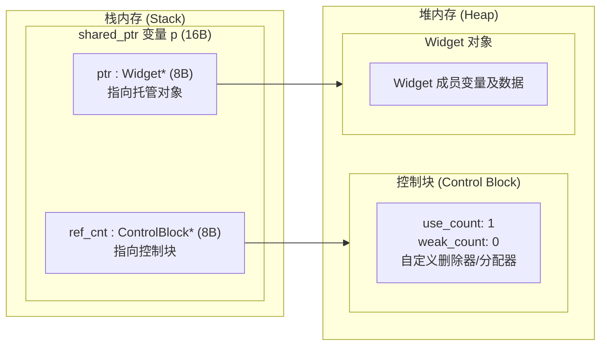
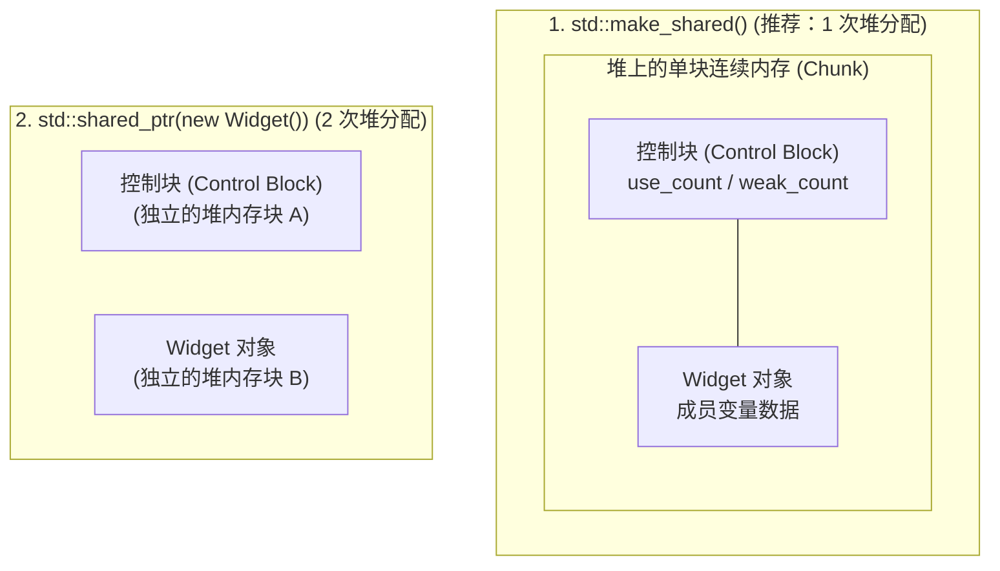

# 智能指针

<!-- more -->

智能指针和裸指针最大的区别就是在new了之后不需要手动清空内存，智能指针实际上是一个类，里面管理着裸指针，在智能指针使用完毕后调用析构函数时就会把申请的内存顺手清空而不需要手动清空。这就是 [RAII](../RAII.md)：资源绑在对象寿命上，析构时一定还回去。

头文件：`#include <memory>`
类模板: `unique_ptr<数据类型> 变量`
一个 unique_ptr 类型的智能指针管理一个内存

声明一个智能指针： `unique_ptr<Person> pu;`


## `unique_ptr`（独占所有权）
 **机制**：同一时刻**有且仅有一个** `unique_ptr` 可以拥有并指向该资源。
 
 **开销**：零额外开销，其大小和性能与裸指针（raw pointer）完全一致。


### get()获取裸指针


### reset()释放对象

`pu.reset()`  释放pu对象指向的资源对象
`pu.reset(nullptr)` 释放pu对象指向的资源对象
`pu.reset(new Person("泪叶丝", 21))`  释放pu指向的资源对象，同时指向新的对象

### swap()交换两个unique_ptr的控制权


## **`std::shared_ptr`（共享所有权）**
**机制**：允许多个 `shared_ptr` 共同指向同一个对象。

**开销**：内部有一个**控制块（Control Block）**，维护着**引用计数（Reference Count）**。每多一个指针指向该资源，计数加 1；指针销毁时计数减 1，当计数归零时才真正释放资源。

关于写法：
```cpp
// 写法 A：直接 new
std::shared_ptr<Widget> sp1(new Widget());

// 写法 B：使用 make_shared
auto sp2 = std::make_shared<Widget>();

```

A: 触发两次堆分配，一次是`new`分配对象本身，一次是共享指针内部创建控制块存放引用计数。

B: 触发一次堆分配，`make_shared` 直接申请一块连续内存，这块内存大小为对象+控制块，然后直接在内存里构造对象。
这样不仅少了一次内存分配开销，还能让对象和控制块紧挨在一起，大大提高了CPU缓存命中率。

### 内存分布




## 两种堆分配方式的内存对比



