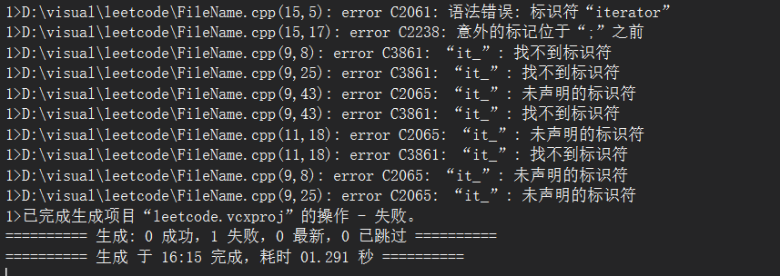

# 自动推导decltype

<!-- more -->

为"declare type"缩写，和[auto](自动推导auto关键字.md)一样都是属于自动推导，区别在于**auto需要进行初始化，而decltype则不需要**。
```cpp
decltype(表达式)
```
举个例子：
```cpp
int a = 10;
decltype(a) b = 20; //得到b->int
decltype(a+3.14) c = 45.55 //得到c->double
decltype(a+b*c) d = 1145.14 //得到d->double
```

## 推导规则
这样看这个很简单啊，不过还是需要补充一些细节，如果有下面这么一段代码：
```cpp
const int x = 20;
const int& ref = x;

auto a = ref;
decltype(ref) b = x;
```
那么a和b分别是什么类型？

首先b和ref一样都是`const int&`类型，但是a却是`int`类型，原因是什么呢？-> 进行`auto`初始化的时候会进行类型退化，也就是引用`&`会被剥离，然后顶层的`const`也会被剥离，因为a是一个全新副本，修改a不会影响原来的x。

## 进阶

`decltype(x)`和`decltype((x))`是一样的吗？

- **`decltype(x)`（单层括号）**：如果括号内是一个无括号包裹的**变量名**，`decltype` 会直接返回该变量**声明时的精准类型**。
- **`decltype((x))`（双重括号）**：如果加上了额外的圆括号，`x` 就不再被看作单独的变量名，而是被当作一个**表达式**。在 C++ 中，变量表达式求值的结果是**左值**，因此 `decltype((x))` 会强制推导出**左值引用（`&`）**

```cpp
    int num = 100;

    decltype(num) v1 = num;   // 1. v1 的类型是什么？
    decltype((num)) v2 = num; // 2. v2 的类型是什么？

```

根据以上内容可以总结出：
v1的类型是`int`，和num一致
v2的类型是`int&`，原因和上面一样此时num为一个表达式->左值，所以得到左值引用

### 在模板中的应用与尾置返回类型

### 模板应用

先看代码：
```cpp
#include <iostream>
#include <vector>
#include <list>
template<class T>
class Iterator {
public:
	void print(T& t)
	{
		for (it_ = t.begin(); it_ != t.end(); ++it_)
		{
			std::cout << *it_ << std::endl;
		}
	}
private:
	T::iterator it_;
};

int main()
{
	std::vector<int>v{ 1,2,3,4,5,6,7,8,9 };
	std::list<std::string>ls{ "11","22","33","44" };
	Iterator<std::vector<int>> p;
	std::cout << "\n";
	Iterator<std::list<std::string>> q;
	q.print(ls);
	p.print(v);
}
```
进行编译会发现报错：


这是为什么呢？
根据报错答案在
```cpp
T::iterator it_;
```
其实`T::iterator`是一个嵌套依赖名称，编译模板时编译器不知道`T`具体是哪个容器，无法判断这到底是**类型名称**还是**静态变量**。默认会按照后者进行处理，就引发了报错。此时我们可以利用`decltyoe`关键字对类型进行自动推导：`decltype(T().begin())`，利用`T()`创建一个临时容器对象，再访问`beigin`函数获取迭代器的类型即可：
```cpp
#include <iostream>
#include <vector>
#include <list>
template<class T>
class Iterator {
public:
	void print(T& t)
	{
		for (it_ = t.begin(); it_ != t.end(); ++it_)
		{
			std::cout << *it_ << std::endl;
		}
	}
private:
	decltype(T().begin()) it_;  //改变写法
};

int main()
{
	std::vector<int>v{ 1,2,3,4,5,6,7,8,9 };
	std::list<std::string>ls{ "11","22","33","44" };
	Iterator<std::vector<int>> p;
	std::cout << "\n";
	Iterator<std::list<std::string>> q;
	q.print(ls);
	p.print(v);
}
```
然后就能正常输出。
当然还有其他方法：
使用`typename`告诉编译器这是一个类型：
```cpp
typename T::iterator it_; //同样能够编译运行
```

### 尾置返回类型

在 C++11 的泛型编程中，两个不同类型的对象相加，返回值类型很难提前预知，比如说：
```cpp
template <typename T, typename U>
??? add(T a, U b) {
    return a + b;
}
```
如果 `a` 是 `int`，`b` 是 `double`，返回类型应该是 `double`。但编译器在解析函数头时，`a` 和 `b` 还没有被声明，无法直接写 `decltype(a + b)`

所以此时就可以使用尾置返回类型：
```cpp
auto func(参数) -> 返回类型
```

补全上面函数就能得到：
```cpp
template <typename T, typename U>
auto add(T a, U b) -> decltype(a+b) 
{
    return a + b;
}
```

当然，在c++14中就能更简便了：
```cpp
template <typename T, typename U>
auto add(T a, U b) //不加后置返回类型，直接用auto
{
    return a + b;
}
```

只是需要注意区别两种写法是存在与哪个版本中。


