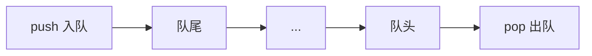

# queue 容器

`std::queue` 是一种遵循**先进先出（FIFO）**的**容器适配器**，头文件 `<queue>`。它不是独立容器，而是在底层容器外面只露出「队尾进、队头出」。



核心特点：

- **两端开口**：`push` 加在队尾，`pop` / `front` 对着队头
- **没有迭代器**：不能 `for (auto x : q)`，也不能用算法遍历
<!-- more -->

- **底层**：默认是 [deque容器](deque容器.md)，也可以换成 `std::list`

常用成员：

| 函数 | 作用 |
|------|------|
| `push(x)` | 元素入队尾 |
| `pop()` | 去掉队头，返回 `void` |
| `front()` | 队头引用 |
| `back()` | 队尾引用 |
| `empty()` | 是否为空 |
| `size()` | 元素个数 |

相关：[STL](STL.md)、[list容器](list容器.md)、[vector容器](vector容器.md)

## 代码例子

```cpp
#include <iostream>
#include <queue>

int main() {
    std::queue<int> q;

    q.push(10);
    q.push(20);
    q.push(30);

    std::cout << "当前队列大小: " << q.size() << "\n";  // 3

    if (!q.empty()) {
        std::cout << "队首: " << q.front() << "\n";  // 10
        std::cout << "队尾: " << q.back() << "\n";   // 30
    }

    std::cout << "--- 开始出队 ---\n";
    while (!q.empty()) {
        int val = q.front();  // 先取出
        std::cout << "访问并弹出队首: " << val << "\n";
        q.pop();              // 再丢掉，pop 本身不返回值
    }

    if (q.empty()) {
        std::cout << "队列现在已空。\n";
    }
    return 0;
}
```

**`pop()` 是 `void`**：想拿到被弹出的值，必须先 `front()` 再 `pop()`。空队列上调用 `front()` / `pop()` 是未定义行为，先 `empty()` 判断。
