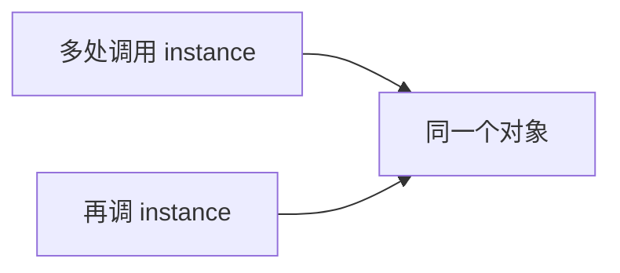
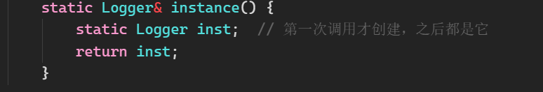

# 单例模式

<!-- more -->

相关：[构造函数和析构函数](../构造函数和析构函数.md)、[互斥锁](../../C++11现代特性/互斥锁.md)、[工厂模式](工厂模式.md)

一个类在整个程序里**只允许有一个实例**，并且有一个全局入口拿到它。配置、日志、连接池这类「全进程共享一份」的东西才会用。



做法就三件事：

1. 构造函数放到 `private`，外面 `Logger x;` 编不过
2. 拷贝 / 赋值删掉，防止 `Logger b = a;` 再克隆一份
3. 提供静态的 `instance()`，内部创建并返回那唯一一份

## 局部静态（Meyers）

C++11 起，函数里的 `static` 局部变量**第一次进来时才构造**，并且初始化是线程安全的。

```cpp
#include <iostream>

class Logger {
public:
    static Logger& instance() {
        static Logger inst;  // 第一次调用才创建，之后都是它
        return inst;
    }

    Logger(const Logger&) = delete;
    Logger& operator=(const Logger&) = delete;

    void log(const char* msg) {
        std::cout << msg << "\n";
    }

private:
    Logger() = default;
};

int main() {
    Logger::instance().log("hello");
    Logger::instance().log("world");  // 还是同一个对象
    return 0;
}
```

`instance()` 返回**引用**，不要返回指针再自己 `delete`。对象活到程序结束，析构由运行时收。

## 另外两种写法

**饿汉**：程序启动就把实例造好。实现简单，但即使从来不用也占着。

```cpp
class Hungry {
public:
    static Hungry& instance() { return inst; }
    Hungry(const Hungry&) = delete;
    Hungry& operator=(const Hungry&) = delete;
private:
    Hungry() = default;
    static Hungry inst;
};
Hungry Hungry::inst;  // 定义放 cpp
```

**懒汉 + 锁**：第一次用才 `new`。指针版必须加 [互斥锁](../../C++11现代特性/互斥锁.md)，否则两个线程会各 `new` 一次，单例就破了。能用 Meyers 就别手写这套。

```cpp
// 仅作对比，不要当首选
static Logger* p = nullptr;
static std::mutex mtx;

Logger& bad_lazy() {
    std::lock_guard<std::mutex> lock(mtx);
    if (!p) p = new Logger();
    return *p;  // 还要考虑谁 delete
}
```

## 疑问



Q：我知道这个函数用 `static` 是为了确保对象唯一性，但里面为什么也需要 `static`？函数返回类型不是对象本身吗？应该不需要 `static` 关键字了吧？

A：这里其实把两个 `static` 的分工弄反了。**保证「只有一份、而且函数返回后还活着」的，是里面的 `static Logger inst`。函数上的 `static` 跟唯一性无关。**

| static的位置                        | 作用                                                                                                     |
| -------------------------------- | ------------------------------------------------------------------------------------------------------ |
| `static Logger& instance()` 函数本身 | **怎么调用**：构造已经是 `private`，外面造不出 `Logger` 对象，没法写 `obj.instance()`。成员函数加 `static` 才能 `Logger::instance()` |
| `static Logger inst;` 局部变量       | **存哪以及生命周期是多久**：第一次执行到这行才构造，放进静态存储区，程序结束前都在。这才是单例                                                      |

`Logger&` 也不是「返回对象本身」，只是给**已经存在的那个对象**起个别名。引用必须绑在一个还活着的对象上，它自己不会把对象留住。

### 如果把里面的 `static` 去掉会怎样？

```cpp
static Logger& instance() {
    Logger inst;       // 普通局部变量，在栈上
    return inst;       // 返回引用 —— 但 inst 马上要销毁
}
```

函数一返回，栈上的 `inst` 立刻析构。外面拿到的 `Logger&` 指向已经没了的对象，再 `.log()` 就是未定义行为（悬空引用）。编译器通常会警告 `returning reference to local variable`。

每次进来都会在栈上**新造一个、用完就拆掉**，并不是「堆里同时躺着 100 个 Logger」。单例既不唯一，引用也不安全。

所以：外面那个 `static` 解决「私有构造下怎么调用」；里面那个 `static` 解决「对象放静态区、只初始化一次、返回引用才合法」。少了里面那个，`Logger&` 再怎么写也留不住对象。

## 容易踩的点

- 只藏构造不够，**拷贝构造和赋值也要删**，否则一份单例被拷成两份
- `instance()` 不要返回值类型（会拷贝），返回 `Logger&`
- 单例里再持有另一个单例，析构顺序不好控，尽量让单例自己管自己的资源，见 [RAII](../../RAII.md)
- **能不用就不用**。满项目 `XXX::instance()` 等于隐形全局变量，测起来、改起来会增加负担。真正「全局只能有一份」再用
