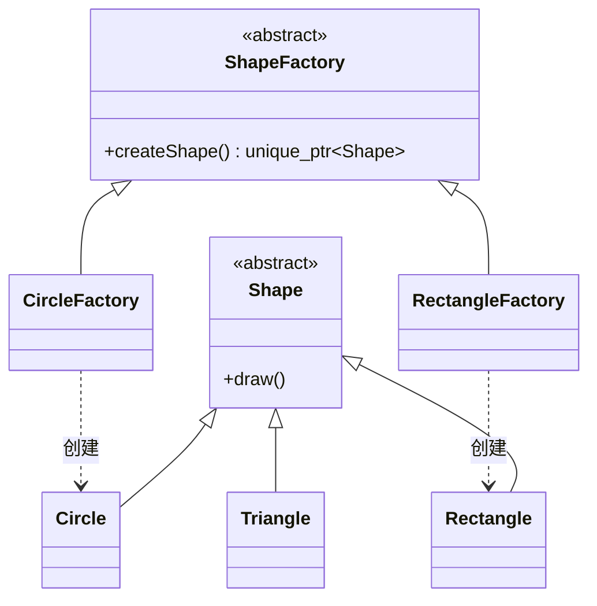

# 工厂模式

<!-- more -->

相关：[继承](../继承.md)、[多态](../多态.md)、[智能指针](../../C++11现代特性/智能指针.md)、[单例模式](单例模式.md)

**不让业务代码直接 `new` 具体类**，而是找一个工厂来「生产」对象。调用方只认抽象接口，换产品时尽量少改旧代码。

图形例子：业务只知道 `Shape`，圆形、矩形、三角形由工厂造出来。



## 简单工厂：一个工厂里 switch

一个工厂类，`if / switch` 看类型再 `new`。写起来短，但**每加一种图形都要改工厂源码**，开闭原则（对扩展开放、对修改关闭）守不住。

```cpp
enum class Kind { Circle, Rect };

std::unique_ptr<Shape> SimpleFactory::create(Kind k) {
    if (k == Kind::Circle) return std::make_unique<Circle>(1.0);
    return std::make_unique<Rectangle>(3, 4);
}
```

类型一多，这个函数就会变成大开关。

## 工厂方法：一种产品配一个工厂

把工厂也做成抽象类。每个具体产品对应一个具体工厂。加三角形 = **新写两个类**，旧的 `renderShape` 不用动。

容易混的两点：

**1. 为什么 `renderShape(ShapeFactory&)` 能接 `CircleFactory`？**  
`CircleFactory` **是一种** `ShapeFactory`（[继承](../继承.md)）。基类引用绑派生类对象，调用虚函数 `createShape()` 时走派生类实现，这就是 [多态](../多态.md)。

**2. 工厂接口是无参的 `createShape()`，圆形却需要半径？**  
参数在**造工厂时**先存进工厂对象，生产时再转给产品构造函数：`CircleFactory c(1.0);` → `make_unique<Circle>(radius_)`。

产品用 `std::unique_ptr<Shape>` 交出去，所有权清楚，析构自动 `delete`，见 [智能指针](../../C++11现代特性/智能指针.md)、[RAII](../../RAII.md)。抽象基类要有 `virtual ~Shape() = default;`，否则只删到基类那一段。

```cpp
#include <iostream>
#include <memory>

class Shape {
public:
    virtual void draw() = 0;
    virtual ~Shape() = default;
};

class Circle : public Shape {
public:
    explicit Circle(double r) : radius_(r) {}
    void draw() override {
        std::cout << "绘制半径为 " << radius_ << " 的圆形\n";
    }
private:
    double radius_;
};

class Rectangle : public Shape {
public:
    Rectangle(double w, double h) : width_(w), height_(h) {}
    void draw() override {
        std::cout << "绘制宽 " << width_ << " 高 " << height_ << " 的矩形\n";
    }
private:
    double width_;
    double height_;
};

class Triangle : public Shape {
public:
    void draw() override { std::cout << "绘制三角形\n"; }
};

class ShapeFactory {
public:
    virtual std::unique_ptr<Shape> createShape() = 0;
    virtual ~ShapeFactory() = default;
};

class CircleFactory : public ShapeFactory {
public:
    explicit CircleFactory(double r) : radius_(r) {}
    std::unique_ptr<Shape> createShape() override {
        return std::make_unique<Circle>(radius_);
    }
private:
    double radius_;
};

class RectangleFactory : public ShapeFactory {
public:
    RectangleFactory(double w, double h) : width_(w), height_(h) {}
    std::unique_ptr<Shape> createShape() override {
        return std::make_unique<Rectangle>(width_, height_);
    }
private:
    double width_, height_;
};

class TriangleFactory : public ShapeFactory {
public:
    std::unique_ptr<Shape> createShape() override {
        return std::make_unique<Triangle>();
    }
};

void renderShape(ShapeFactory& factory) {
    auto s = factory.createShape();
    s->draw();
}

int main() {
    CircleFactory c(1.0);
    RectangleFactory r(3.5, 4.6);
    TriangleFactory t;
    renderShape(c);
    renderShape(r);
    renderShape(t);
    return 0;
}
```

加一种新产品：只新增产品类 + 工厂类，上面的 `renderShape` 保持不动。代价是类的数量大约翻倍。

## 进阶：画布批量画

真正画画不是画一个就扔。用 `std::vector<std::unique_ptr<Shape>>` 让 `Canvas` 独占所有图形：

- 存基类指针，才能把圆、矩形放进同一个容器（多态）
- `addShape` 里 `emplace_back(std::move(shape))`，`unique_ptr` 不能拷只能移
- 构造时 `shapes_.reserve(n)` 预留容量，不要 `resize`（`resize` 会先塞进 n 个空指针）

```cpp
class Canvas {
public:
    explicit Canvas(size_t n = 10) { shapes_.reserve(n); }

    void addShape(std::unique_ptr<Shape> shape) {
        shapes_.emplace_back(std::move(shape));
    }

    void drawAll() const {
        for (const auto& s : shapes_) s->draw();
    }

private:
    std::vector<std::unique_ptr<Shape>> shapes_;
};

// canvas.addShape(c.createShape());
```

这里用 `unique_ptr` 而不是 `shared_ptr`：画布是图形的唯一主人，没必要引用计数。容器细节见 [vector容器](../../STL/vector容器.md)。
