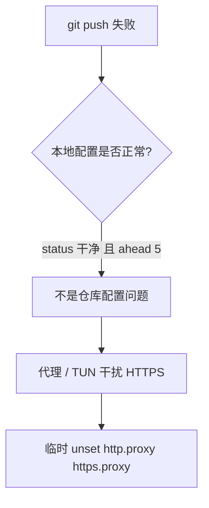
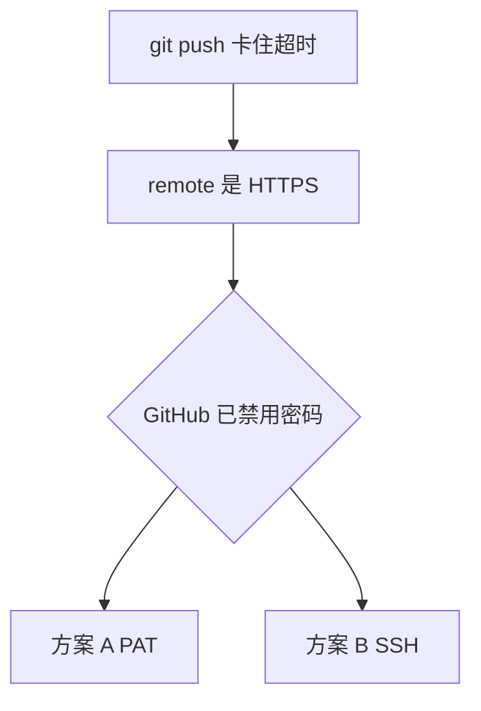

# git push 失败排查



<!-- more -->

按现象分开记。第一次把代码传到 GitHub、嵌套仓库、蓝锁这类「流程」问题，看 [关于上传到自己的远程仓库](关于上传到自己的远程仓库.md)。

## 1. 本地很干净，但 push 不出去：代理


检查：

```
git status
# On branch main
# Your branch is ahead of 'origin/main' by 5 commits.
# nothing to commit, working tree clean

git remote -v
# origin  https://github.com/worldfunction4/dsh-desk.git
```

仓库本身没问题，多半是网络。TUN 开着、又给 git 配了代理时，HTTPS 可能反而走不通。临时拆掉：

```powershell
git config --global --unset http.proxy
git config --global --unset https.proxy
```

当前 PowerShell 窗口里环境变量也可能残留：

```powershell
$env:http_proxy=""
$env:https_proxy=""
```

要走代理就写对端口：

```powershell
git config --global http.proxy http://127.0.0.1:端口
git config --global https.proxy http://127.0.0.1:端口
```

全局拆干净了还连不上，看配置到底从哪来的：

```powershell
git config --global --list --show-origin
```

全局没有代理时，`127.0.0.1` 只可能来自**当前仓库的本地配置**或 **Windows 环境变量**。

## 2. rejected / fetch first：远程有你没有的提交

```
! [rejected] main -> main (fetch first)
error: failed to push some refs
hint: Updates were rejected because the remote contains work that you do not have locally.
```

远程 GitHub 上有本地没有的新提交。若确定远程可以被覆盖：

```powershell
git push --force-with-lease origin main   # 远程若又有新提交会拒绝，相对安全
git push --force origin main              # 不管远程，直接盖掉
```

有别人一起推的仓库，不要用第二种。

## 3. push 卡住超时：HTTPS 认证



remote 是 `https://github.com/...` 时，GitHub 从 2021 年起不再接受账户密码，要 Personal Access Token 或 SSH。终端弹出密码框、输入 GitHub 密码被拒，看起来会像「卡住 / 无法执行」。

**方案 A：PAT**

1. [生成 classic token](https://github.com/settings/tokens)，勾选 `repo`，只显示一次，立刻复制
2. `git push` 时用户名填 GitHub 用户名，密码处粘贴 token（不会回显）
3. 可缓存：`git config --global credential.helper wincred`

**方案 B：SSH**

```powershell
ssh-keygen -t ed25519 -C "GitHub邮箱"
# 公钥放到 https://github.com/settings/keys
git remote set-url origin git@github.com:用户名/仓库.git
git push
```

有一次准备上 PAT，还没改认证就已经能 push 了——上次失败不一定是认证，也可能是上一节的代理。AI 按「HTTPS + 密码框」直接断定认证失败，不一定对。
