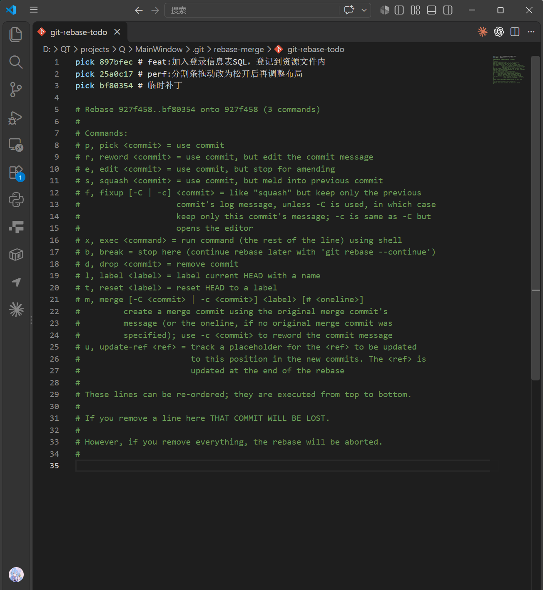
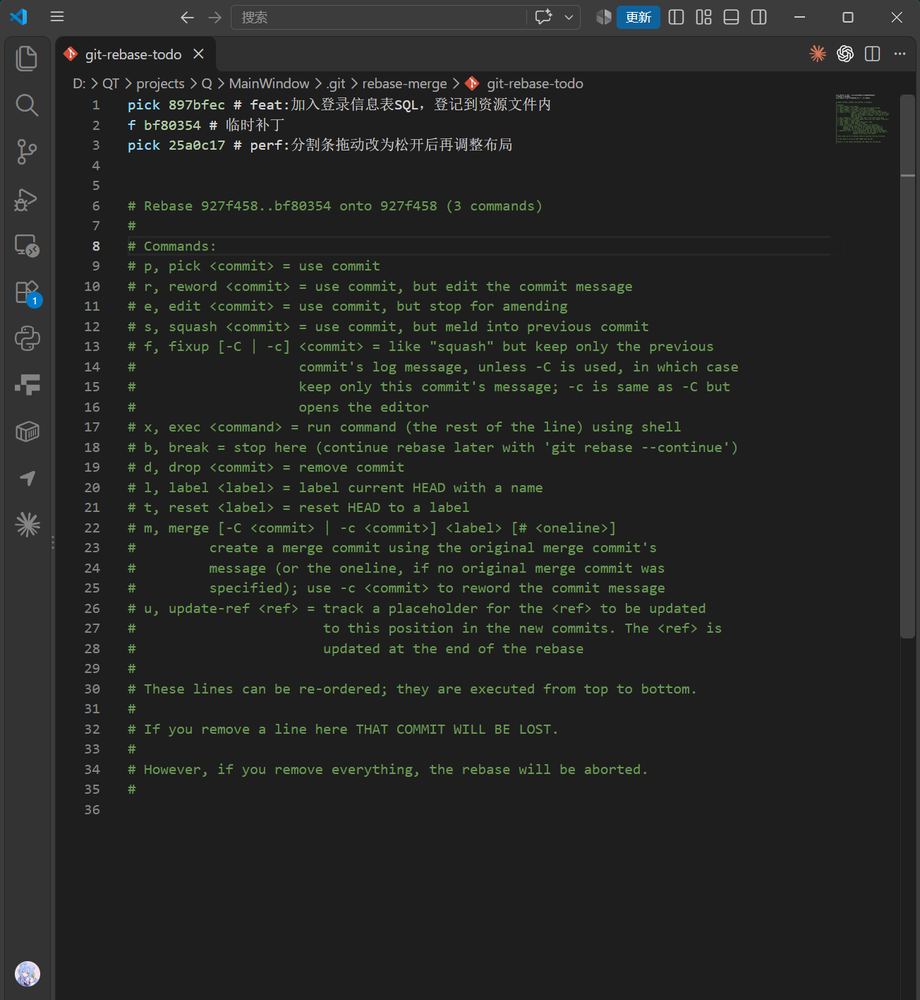
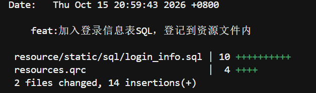

# 使用git进行commit发现自己遗漏了文件怎么办？

## 如果是最后一次提交的commit遗漏了文件
### commit还在本地未提交
1. 先把文件添加到暂存区：
```bash
git add 文件
```
2. 使用`--amend`参数追加到上一次提交
```bash
git commit --amend --no-edit
```
- `--no-edit`：表示让上一次的commit信息不变，直接把新文件融进去即可，如果需要重新修改提交说明可以去掉这个参数

### commit已经提交到远程仓库
这个情况下不能直接使用`--amend`推送，因为会导致远程和本地的提交历史记录产生冲突（`--amend`会改变commit的哈希值），那么这时候需要处理：
1. 把遗漏的文件同样先加到暂存区
```bash
git add 文件
```
2. 追加到本地的上一次 commit
```bash
git commit --amend --no-edit
```
3. 强制推送到远程仓库
```bash
git push origin 分支名 --force
```


## 如果是还要更早的commit遗漏了文件
这时候就需要使用**交互式变基**，英文为**Interactive Rebase**

1. 遗漏的文件提交为临时补丁
```bash
git add 文件
```
2. 提交这个临时修改
```bash
git commit -m "temp fix"
```
3. 寻找需要的提交是哪个，这里假设为倒数第二个，去找最近3次的提交
```bash
git rebase -i HEAD~3
```
4. 运行上面的命令后，会弹出一个文本编辑器，里面会显示最近的 3 行提交（顺序为从上到下->从旧到新）
```Plaintext
pick 927f458 feat:接入SQLite，启动时通过ManDB类连接数据库
pick 897bfec feat:加入登录信息表SQL，登记到资源文件内
pick 25a0c17 perf:分割条拖动改为松开后再调整布局
pick xxxxxx temp fix
```
附上截图：
<!-- more -->


进行修改：

这里就做了两个步骤：
- **调整顺序**：把最后一行刚刚创建的 `pick bf80354 # 临时补丁` fix` **剪切并移动到** 想要合并进去的那个目标 commit（即 `feat:加入登录信息表SQL，登记到资源文件内`）的**下一行**
    
- **改动命令**：把 `临时补丁` 那一行的开头单词从 `pick` 改为 **`f`**（代表 `fixup`，意思是“把这次提交的内容合并到上面那一个 commit 中，并且丢弃当前的提交信息”）

保存退出后git就会自动开始重演了


添加成功了
