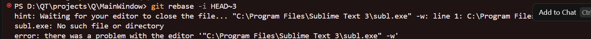

# 现象
如图
<!-- more -->




# 原因
这是在执行交互式变基命令 `git rebase -i HEAD~3` 时触发的 **Git 默认编辑器配置失效错误**，Git 在执行交互式变基（rebase -i）时需要打开一个文本编辑器供修改 commit 历史记录
根据提示信息可以知道：
- 之前配置了 **Sublime Text** (`subl.exe`) 作为 Git 的默认编辑器
- 但当前路径 `"C:\Program Files\Sublime Text 3\subl.exe"` 下找不到该可执行文件，可能是因为 Sublime Text 被卸载、移动了位置，或者路径中包含空格未被正确转义

# 解决
这样的话很明显有两张方法了：更换或者修复路径
## 更换
这里使用更换VSCode：
```bash
git config --global core.editor "code --wait"
```
记录一下其他的，比如自带的记事本：
```bash
git config --global core.editor "notepad"
```

## 修复
检查其安装路径并使用以下命令：
```bash
git config --global core.editor "'C:/Program Files/Sublime Text 3/subl.exe' -w"
```
又或者直接将 `subl.exe` 所在目录添加到系统环境变量 `PATH` 中，然后执行：
```bash
git config --global core.editor "subl -n -w"
```
