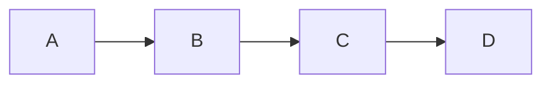
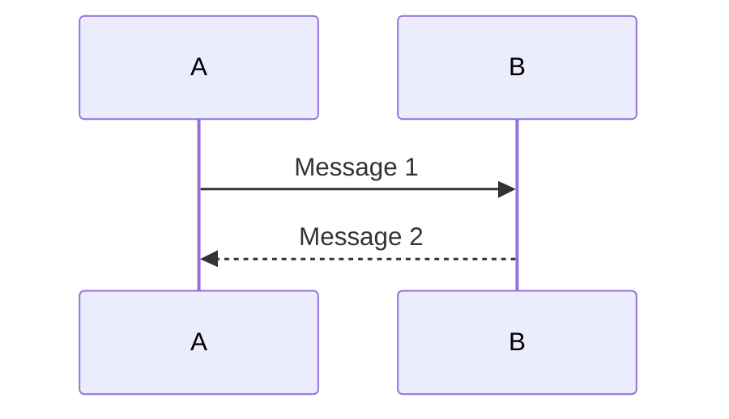
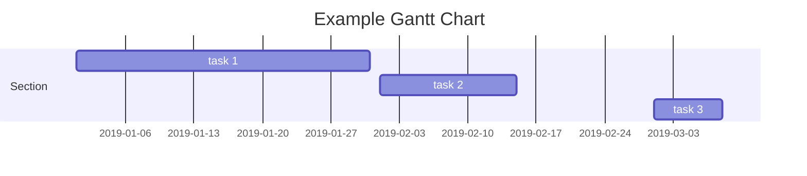
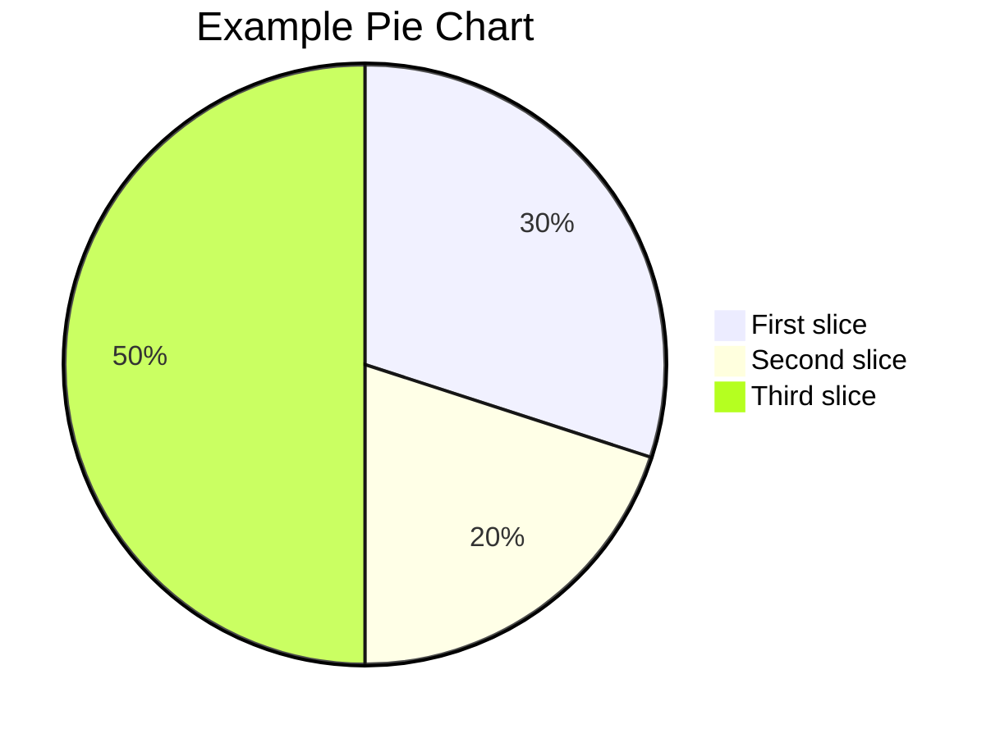

# Mermaid

[官方文档](https://mermaid.js.org/intro/)

用文本画图：流程图、时序图、甘特图、饼图等。本库里 OSPF、线程、STL 已经在用。Markdown（Obsidian / VuePress）里写成 ` ```mermaid ` 代码块就会渲染。

日常画图优先用编辑器预览，不必单独装 CLI。语法不对时，把同一段丢进 [Mermaid Live Editor](https://mermaid.live/) 对照。

本库习惯用 `flowchart`，比旧的 `graph` 更清楚。下面每类图都是「源码 + 渲染」对照。

## 流程图

```text
flowchart LR
   A --> B
   B --> C
   C --> D
```



`flowchart` 声明这是流程图，`LR` 是从左到右（还有 `TD` 从上到下）。`-->` 表示箭头。节点要用空格或特殊字符时写成 `A["队头"]`。

## 时序图

```text
sequenceDiagram
   A->>B: Message 1
   B-->>A: Message 2
```



`->>` 实线带箭头，`-->>` 虚线。冒号后面是这条消息的文字。适合画协议握手、线程交互。

## 甘特图

```text
gantt
   title Example Gantt Chart
   dateFormat  YYYY-MM-DD
   section Section
   task 1: 2019-01-01, 30d
   task 2: 2019-02-01, 14d
   task 3: 2019-03-01, 7d
```



`dateFormat` 定日期写法，任务写成 `名字: 开始日期, 持续天数`。

## 饼图

```text
pie
   title Example Pie Chart
   "First slice": 30
   "Second slice": 20
   "Third slice": 50
```



标签加引号，冒号后面是数值。其它图种需要时再查官方文档。
