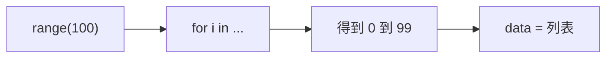
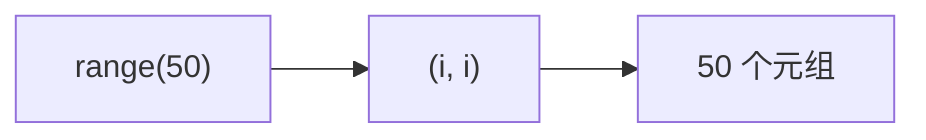

# 关于列表

<!-- more -->

今天在学习[concurrent.futures模块](concurrent.futures模块.md)时用列表生成测试数据偶然发现：

```python
data = [i for i in range(100)]
```



这是列表生成式（list comprehension）：`range(100)` 给出 0 到 99，每个 `i` 放进列表，再赋给 `data`。

再一种：

```python
data = [(i, i) for i in range(50)]
```



得到 50 个 `(i, i)` 元组，`i` 从 0 到 49。更完整的写法见 [列表推导式](列表推导式.md)。