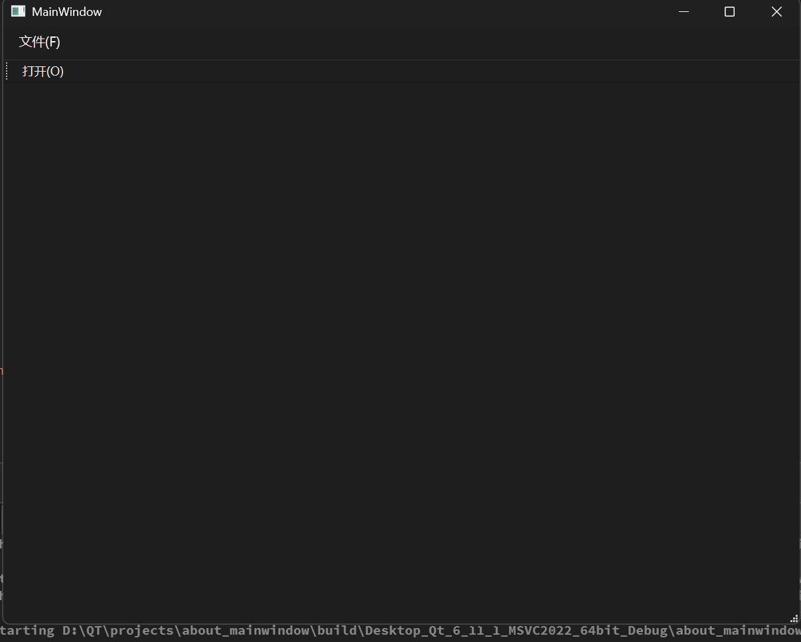

#  主窗口
所谓`QMainWindow`和`QWidget`最大的区别就是后者默认是一张什么都没有的白纸，前者是专门为了构建**大型桌面应用程序**设计的标准主窗口结构，内部划分了几个经典区域：
## `QMainWindow` 的五大黄金区域

-  **菜单栏（`QMenuBar`）**：位于最顶部，可以添加“文件”、“编辑”、“帮助”等下拉菜单。
-  **工具栏（`QToolBar`）**：位于菜单栏下方，通常放置经常使用的图标按钮（如保存 、撤销 ）。
-  **锚定窗口（`QDockWidget`）**：可停靠、可拖拽的小面板（像 IDE 侧边栏的文件树或控制台）。
-  **状态栏（`QStatusBar`）**：位于最底部，用来显示提示文字、当前状态或进度条。
-  **中央核心区（`Central Widget`）**：主窗口正中间放置主要业务界面（如表格、编辑器等）的地方。

##  如何在代码中快速添加菜单栏与工具栏？
这里说明一下`QAction`以及在菜单栏和工具栏的使用

###  什么是`QAction`？ 
`QAction` 代表一个“动作”或“命令”（例如：“打开文件”、“保存”）。它的优点是同一个 `QAction` 既可以放在菜单栏里，也可以放到工具栏作为按钮，甚至能绑定快捷键。

举个例子：
```cpp
#include <QMainWindow>
#include <QMenuBar>
#include <QToolBar>
#include <QAction>
#include <QMessageBox>

// 假设在 QMainWindow 的构造函数中：
// 1. 获取窗口默认自带的菜单栏[cite: 1]
QMenuBar *menuBar = this->menuBar();

// 2. 添加一个顶级菜单“文件”[cite: 1]
QMenu *fileMenu = menuBar->addMenu("文件(&F)");

// 3. 创建一个动作 Action（动作名称为“打开”）
QAction *openAction = new QAction("打开(&O)", this);
openAction->setShortcut(QKeySequence("Ctrl+O")); // 设置快捷键 Ctrl+O

// 4. 把动作放到“文件”菜单中[cite: 1]
fileMenu->addAction(openAction);

// 5. 创建工具栏，并将同一个动作加到工具栏中[cite: 1]
QToolBar *toolBar = this->addToolBar("主工具栏");
toolBar->addAction(openAction); // 工具栏上也会出现“打开”按钮[cite: 1]

// 6. 绑定点击动作引发的响应（信号与槽）[cite: 1]
connect(openAction, &QAction::triggered, this, [=](){
    QMessageBox::information(this, "提示", "点击了打开操作！");
});
```

其中：
- `QMenuBar *menuBar = this->menuBar();`：其中`this->menuBar()`是一个成员函数（方法）调用，在 `QMainWindow` 类内部，默认定义了一个名为 `menuBar()` 的成员函数
- 其他代码同理
- lambda表达式采用值捕获的方式弹出一个对话框

运行结果如下：
<!-- more -->



