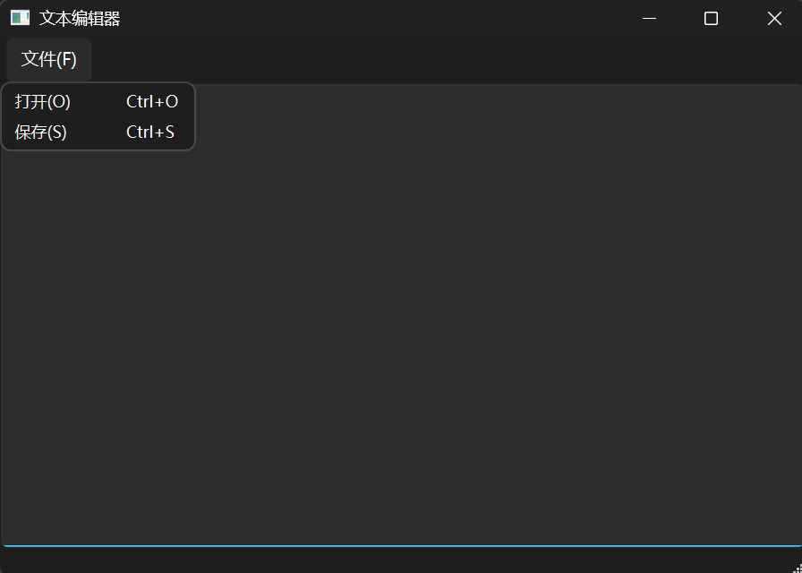

#  前传
通过写一个文本编辑器来进行复习以及应用，并进行记录。

#  开始
##  创建新项目
创建了一个新项目，选择qwidget，类使用MainWindow。

##  搭建界面
创建了一个`MainWindow`类，在主窗口中央放一个文本输入区域，我们需要用到 `QTextEdit` 控件：
```cpp
#include <QTextEdit>
```
在`mainwindow.h`中添加头文件，然后在`mainwindow.cpp`中进行定义：
```cpp
// 初始化文本框
textEdit_ = new QTextEdit(this);
this->setCentralWidget(textEdit_); //这个函数是为了将一个控件放在正中央区域
```
这里一开始写成了：
```cpp
// 初始化文本框
QTextEdit* edit = new QTextEdit(this);
this->setCentralWidget(edit); //这个函数是为了将一个控件放在正中央区域
```
进行运行无法正确打开并写入文本框，程序会崩溃退出，这是因为
```text
1. 构造函数创建的是局部变量 `edit`
    
    mainwindow.cpp:10
    
    ```
    QTextEdit* edit = new QTextEdit(this);
    this->setCentralWidget(edit);
    ```
2. 打开文件后，程序却向成员变量 `textEdit_` 写入内容
    
    mainwindow.cpp:48
    
    ```
    if(textEdit_ == nullptr)
    ```
    
3. `textEdit_` 初始化为 `nullptr`，之后从未赋值
    
    mainwindow.h:33
    
因此，即使文件已经被 `QFile` 成功读取，程序仍会进入空指针判断，弹出“未在构造函数中初始化”，文本不会显示。
```
遇到疑问：**为什么这样做无法打开文件？**
答案：并不是`QTextEdit`创建失败，而是这么做地址保存在不同的指针变量中，之前的代码发生了两件事情：
- `new QTextEdit(this)` 创建成功，文本框对象存在于堆上
-  `edit` 是构造函数内部的局部指针，构造函数结束后，这个指针变量就消失了

不过文本框对象不会随之销毁，因为：
- 它的父对象是 `this`，也就是 `MainWindow`
- Qt 的父子对象机制会让它继续存在
- `setCentralWidget(edit)` 也让主窗口持有这个控件

因此，界面上的文本框其实创建成功，后面使用了`texteEdit_`和`edit`是两个不同的指针。

更改后运行：
<!-- more -->


设置标题以及窗口：
```cpp
this->resize(600, 400);
this->setWindowTitle("文本编辑器");    
```

设置菜单：
```cpp
 //设置开始菜单
QMenu* filemenu = this->menuBar()->addMenu("文件(&F)");
```

设置打开和保存操作：
```cpp
//创建打开操作并绑定热键
QAction* openAction = new QAction("打开(&O)", this);
openAction->setShortcut(QKeySequence("ctrl+o"));

QAction* saveAction = new QAction("保存(&S)", this);
saveAction->setShortcut(QKeySequence("ctrl+s"));

//添加到菜单栏中
fileMenu->addAction(openAction);
fileMenu->addAction(saveAction);

//绑定
connect(openAction, &QAction::triggered, this, &MainWindow::openFile);
connect(saveAction, &QAction::triggered, this, &MainWindow::saveFile);
```
运行结果如下：


##  实现功能
要实现上面中打开和保存操作，需要用到一个类：`QFileDialog`。绝大多数情况下，直接使用 `QFileDialog` 提供的**静态方法**是最快捷的做法，不需要手动实例化对象，具体用法在[QFileDialog](../QFileDialog.md)。

这里需要使用单个文件进行打开：
```cpp
QString fileName = QFileDialog::getOpenFileName(
    this,                                    // 父窗口
    "选择要打开的文件",                        // 对话框标题
    "C:/",                                   // 默认打开路径
    "文本文件 (*.txt);;图像文件 (*.png *.jpg);;所有文件 (*.*)" // 格式过滤器
);

if (!fileName.isEmpty()) {
    qDebug() << "选中的文件路径：" << fileName;
}
```

也就是：
```cpp
void MainWindow::openFile()
{
    //弹出文件选择对话框获取路径
    QString fileName = QFileDialog::getOpenFileName(this, "打开文本文件", "C:/", "文本文件 (*.txt);;所有文件 (*.*)");
    if(fileName.isEmpty())return;

    QFile file(fileName);
    if (!file.open(QIODevice::ReadOnly | QIODevice::Text)) {
        QMessageBox::warning(this, "错误", "无法打开所选文件！");
        return;
    }
    //读取文本内容并设置到 QTextEdit
    QTextStream enter(&file);
    if(textEdit_ == nullptr)
    {
        QMessageBox::critical(this, "崩溃原因诊断", "textEdit_ 是空指针！未在构造函数中初始化。");
        return;
    }
    textEdit_->setText(enter.readAll());
    file.close();
}
```

