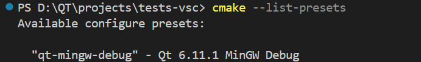
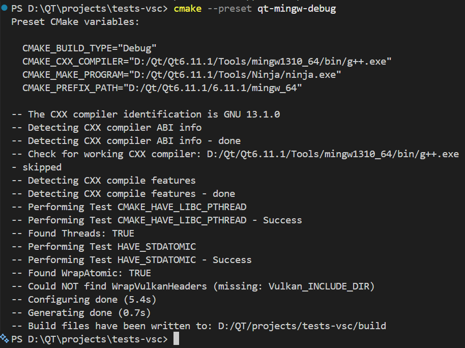

#  切换环境
发现自己基本都在Qt Creator上进行Qt的使用，如果在其他地方？比如VSCode上呢？接下来就以这个为例把这个过程记录下来：

##  利用cmake写构建清单
创建好项目文件夹后在根目录写下`CMakeLists.txt`文件：
```cmake
# 设置cmake最小可构建版本，低于此版本均拒绝执行
cmake_minimum_required(VERSION 3.21)

# 设置项目名称以及使用的语言，这里设置为tests_vsc
project(tests_vsc LANGUAGES CXX)

# 设置C++的标准，这里使用C++11
set(CMAKE_CXX_STANDARD 11)

# 必须使用C++11标准，如果编译器不支持C++11标准就拒绝构建
set(CMAKE_CXX_STANDARD_REQUIRED ON)

# 寻找qt6依赖库, 且声明必须包含Widgets模块
find_package(Qt6 REQUIRED COMPONENTS Widgets)

# 自动配置一系列Qt项目必须的底层设定，由于Qt6.2+引入
qt_standard_project_setup()

# 创建tests-vsc可执行文件目标，并将main.cpp作为源文件引入
qt_add_executable(tests-vsc
    main.cpp
)

# 将Qt6::Widgets模块连接到目标tests-vsc, PRIVATE 表示该依赖项仅在构建 `tests-vsc` 内部时生效，不会向上层或导出目标传递
target_link_libraries(tests-vsc PRIVATE Qt6::Widgets)
```


##  配置项目
在VSCode终端中运行了这个：
```bash
cmake -S . -B build -G Ninja `
  -DCMAKE_PREFIX_PATH="D:/Qt/Qt6.11.1/6.11.1/mingw_64" `
  -DCMAKE_CXX_COMPILER="D:/Qt/Qt6.11.1/Tools/mingw1310_64/bin/g++.exe" `
  -DCMAKE_MAKE_PROGRAM="D:/Qt/Qt6.11.1/Tools/Ninja/ninja.exe"
```

这里：

- -S . 表示源码在当前目录。
- -B build 表示生成文件放进 build。
- CMAKE_PREFIX_PATH 告诉 CMake 去哪里找 Qt。
- CMAKE_CXX_COMPILER 指定与这个 Qt 版本匹配的 MinGW 编译器。

##  编译
```bash
cmake --build build
```

编译完成后会在`build/test-vsc.exe`，运行即可。


##  指定编译器等
上述的办法是通过cmake命令时手动指定编译器等位置：
```bash
cmake -S . -B build -G Ninja `
  -DCMAKE_PREFIX_PATH="D:/Qt/Qt6.11.1/6.11.1/mingw_64" `
  -DCMAKE_CXX_COMPILER="D:/Qt/Qt6.11.1/Tools/mingw1310_64/bin/g++.exe" `
  -DCMAKE_MAKE_PROGRAM="D:/Qt/Qt6.11.1/Tools/Ninja/ninja.exe"
```

这样写的原因是编译器必须在 CMake 第一次执行 project() 时确定。如果更换编译器后，要删除缓存或添加使用以下命令：
```bash
cmake --fresh
```

所以采用一种更加方便的方法：**也就是使用`CMakePresets.json`**。

- 为什么不直接写入`CMakeLists.txt`？
其实理论上是可以实现的，比如说：
```cmake
set(CMAKE_C_COMPILER
    "D:/Qt/Qt6.11.1/Tools/mingw1310_64/bin/gcc.exe"
    CACHE FILEPATH "C compiler"
)

set(CMAKE_CXX_COMPILER
    "D:/Qt/Qt6.11.1/Tools/mingw1310_64/bin/g++.exe"
    CACHE FILEPATH "C++ compiler"
)
```
但这样做会造成以下的后果：
- 电脑上绝对路径写进了项目
- 换一台电脑或者Qt版本就会失效
- 其他的开发者可能会使用不同的编译器（MSVC，Clang）或者不同位置的编译器
- 已经生产缓冲再修改这里不一定生效
### 项目根目录创建`CMakePresets.json`
```json
{
  "version": 6,
  "configurePresets": [
    {
      "name": "qt-mingw-debug",
      "displayName": "Qt 6.11.1 MinGW Debug",
      "generator": "Ninja",
      "binaryDir": "${sourceDir}/build",
      "cacheVariables": {
        "CMAKE_BUILD_TYPE": "Debug",
        "CMAKE_PREFIX_PATH": "D:/Qt/Qt6.11.1/6.11.1/mingw_64",
        "CMAKE_CXX_COMPILER": "D:/Qt/Qt6.11.1/Tools/mingw1310_64/bin/g++.exe",
        "CMAKE_MAKE_PROGRAM": "D:/Qt/Qt6.11.1/Tools/Ninja/ninja.exe"
      }
    }
  ]
}
```

###  确认camke能识别预设
执行以下命令是否有预设：
```bash
cmake --list-presets
```

这里会显示以下内容
<!-- more -->



说明成功了。

###  使用预设配置项目
我们设置的名称是`qt-mingw-debug`，所以应该使用以下命令：
```bash
cmake --preset qt-mingw-debug
```
如果之前构建目录使用过另一套编译器的话：
```bash
cmake --preset qt-mingw-debug --fresh
```

正常应该会显示类似以下内容：


因为我们在预设的构建目录是这样的：
```json
"binaryDir": "${sourceDir}/build"
```
所以可以直接执行：
```bash
cmake --build build  # build就是我们预设的构建目录了
```

然后会出现构建目录build，进入运行exe程序：


成功。

###  不同编译器之间写法对比
上面的是使用Qt6 + MinGW组合，如果切换到MSVC的话
需要把CMakePresets.json改成：
```json
{
  "version": 6,
  "configurePresets": [
    {
      "name": "qt-msvc-debug",
      "displayName": "Qt MSVC 2022 Debug",
      "generator": "Visual Studio 17 2022",
      "architecture": "x64",
      "binaryDir": "${sourceDir}/build-msvc",
      "cacheVariables": {
        "CMAKE_PREFIX_PATH": "D:/Qt/Qt6.11.1/6.11.1/msvc2022_64"
      }
    }
  ],
  "buildPresets": [
    {
      "name": "qt-msvc-debug",
      "configurePreset": "qt-msvc-debug",
      "configuration": "Debug"
    }
  ]
}
```
可以看到修改的几个地方：
- 生成器：`Ninja` -> `Visual Studio 17 2022`
- Qt路径：`mingw_64` -> `msvc2022_64`
- 构建目录：build -> build-msvc
- 删除：`CMAKE_CXX_COMPILER`， `CMAKE_MAKE_PROGRAM`，`CMAKE_BUILD_TYPE`

接着再次执行：
```bash
cmake --preset qt-msvc-debug --fresh
cmake --build --preset qt-msvc-debug
```

就可以进入构建目录运行了，当然不同编译器最好使用不同构建目录，因为**构建目录中缓存了编译器信息，即使使用 `--fresh`，为不同工具链分开目录也更清楚、更稳妥。**

###  使用MinGW后再切换到MSVC的错误
现象：切换编译器重新构建后无法构建，执行exe文件无反应

原因：当前终端PATH优先存在MinGW版本的Qt，MSVC启动时加载不到兼容的MinGW Qt DLL，进程存在但Qt窗口没有创建所以”没反应“

修复：
1. 修改CMakeLists.txt：
```cmake
if(WIN32 AND TARGET Qt6::windeployqt)
    add_custom_command(TARGET tests-vsc POST_BUILD
        COMMAND Qt6::windeployqt
                --no-translations
                "$<TARGET_FILE:tests-vsc>"
        COMMENT "Deploying the matching Qt runtime next to tests-vsc"
    )
endif()
```
其中：
- `if(WIN32 AND TARGET Qt6::windeployqt)`：`WIN32`表示当前构建目标为Windows，它在64位Windows也为真，表示Windows平台；`TARGET Qt6::windeployqt`表示检查Qt是否提供了名为`Qt6::windeployqt`的工具目标，这是qt自带的windows部署工具，详细见[windeployqt](../../遇到的一些问题/Qt_Creator外部无法运行exe程序.md#使用-qt-官方打包工具-`windeployqt`)。组合就是：如果正在构建 Windows 程序并且当前 Qt 安装中存在 `windeployqt` 那么执行下面的部署操作。这对跨平台很有用。

- `add_custom_command(TARGET tests-vsc POST_BUILD`：`add_custom_command` 表示给构建过程添加一条自定义命令；`TARGET tests-vsc` 表示此命令属于`tests-vsc`这个程序；`POST_BUILD`表示在 tests-vsc.exe 编译和链接成功之后执行。

- `COMMAND Qt6::windeployqt`：这表示运行 Qt 安装目录中的 `windeployqt.exe`。为什么不直接写绝对路径？比如：`COMMAND "D:/Qt/.../windeployqt.exe"`。因为 `Qt6::windeployqt` 会自动使用当前找到的 Qt 套件。

- ` --no-translations`： 这是传给 `windeployqt` 的参数，表示不复制 Qt 自带的翻译文件。

- `"$<TARGET_FILE:tests-vsc>"`：`$<...>` 这种写法叫 CMake“生成器表达式”，**它不是普通变量，而是在构建时求值**；`TARGET_FILE:tests-vsc`表示取得 `tests-vsc` 目标最终生成文件的完整路径。

- `COMMENT "Deploying the matching Qt runtime next to tests-vsc"`：这只负责在构建输出中显示提示：
```text
Deploying the matching Qt runtime next to tests-vsc
```
它不影响程序行为，主要是让人知道部署步骤正在执行。

- `endif()`： 它与开头的 `if(...)` 对应


2. 增加构建后自动执行