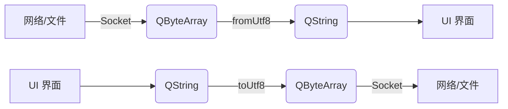
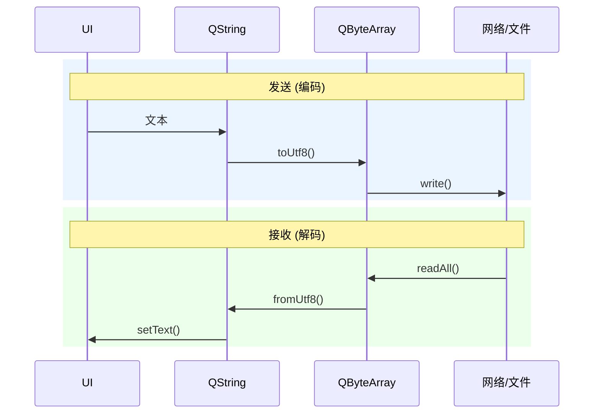

# 字符串类QByteArray和QString

在Qt中也有自己的类，是`QByteArray`和`QString`。

## `QByteArray`

`QByteArray`是用于处理原始字节流的核心类。可以被看做是C++标准库中`std::vector<char>`或`std::string`的Qt增强版，专门针对二进制数据和UTF-8等字符进行高效存储与操作。

### 特性与优势

**写时复制**：赋值和作为函数参数传值时只复制指针，极轻量，仅在修改数据时触发深拷贝。

**支持包含`\0`字节**：与传统C风格以`\0`结尾不同，它可以安全存储包含任意NULL字节的纯二进制数据（比如图片、音频、加密数据等）。

**自动补充`\0`结尾**：虽然支持二进制`\0`，但它在缓冲区末尾会额外保留一个隐式的`\0`，因此可以无缝转化为`const char*`（通过`.constData()`或`.data()`）。

### 使用示例

#### 创建与初始化
```cpp
QByteArray ba1("hello"); //C字符创建
QByteArray ba2(10, 'a'); //包含十个'a'的数组
QByteArray ba3 = QByteArray::formHex("48656c6c6f"); //从十六进制字符串解析
```

#### 与`QString`转换
`QString`内部使用UTF-16编码，而`QByteArray`存储8位字节，两者之间的转换非常频繁：
```cpp
QString str = "你好，泪叶丝";
//QString -> QByteArray
QByteArray utf8_data = str.toUtf8();
// QByteArray -> QString
QString str2 = QString::fromUtf8(utf8_data);
```

#### 数据读写与追加
```cpp
QByteArray ba;
ba.append("Data");
ba.append('\x00'); // 安全写入 NULL 字节
ba.append("More");

char first_byte = ba[0];                 // 像数组一样访问
const char* raw_pointer = ba.constData(); // 获取底层的 const char* 指针
```

#### 进制编码与解码
在网络传输或序列化时，经常需要 Base64 或 Hex 转码：
```cpp
QByteArray text = "Qt Framework";

QByteArray base64 = text.toBase64();      // 转为 Base64
QByteArray hex = text.toHex();            // 转为十六进制字符串

QByteArray restored = QByteArray::fromBase64(base64); // 解码
```


## `QString`

`QString`用于存储和操作**文本字符串**的核心类。与`std::string`不同，`QString`完全采用**UTF-16**编码（每一个字符为一个16位的`QChar`），原生支持全球绝大多数的语言文字和表情符号，是Qt中界面交互、文本处理的基石。

### 特性与优势

**原生 Unicode (UTF-16) 支持：** 处理多语言文本（中文、日文、阿拉伯文等）时无需担心乱码，字符长度和索引计算更加直观。

**写时复制（Implicit Sharing）：** 与 `QByteArray` 一致，浅拷贝只复制指针和引用计数，只有当尝试修改字符串时才会发生深拷贝，非常适合作为函数参数或返回值传递。

**丰富且人性化的 API：** 内置格式化、拼接、分割、正则匹配、编码转换等功能，几乎涵盖日常文本处理的所有场景。

**与 Qt 框架无缝集成：** `QLineEdit`、`QLabel`、`QTextEdit` 等所有 GUI 控件以及信号槽机制，均以 `QString` 为基础数据类型。

### 常用操作

#### 创建与初始化
```cpp
QString s1 = "Hello, Qt";              // 从 C 字符串直接构造
QString s2("泪叶丝");                 // 原生支持 Unicode 字符串字面量
QString s3 = QString::number(42);     // 数字转字符串 ("42")
QString s4 = QString("%1 + %2 = %3")  // 占位符格式化
                 .arg(1).arg(2).arg(3); // 得到 "1 + 2 = 3"
```

#### 字符串拼接与修改
```cpp
QString str = "Hello";
str += " World";                      // 重载运算符 append
str.append("!");                      // 追加文本
str.prepend("Say: ");                 // 在开头插入文本，变为 "Say: Hello World!"
```

#### 查找、替换与切割
```cpp
QString path = "/home/user/documents/file.txt";

// 包含检查与查找
bool hasUser = path.contains("user"); // true
int index = path.indexOf("file");     // 找到位置索引

// 切割与提取
QStringList parts = path.split("/");  // 按斜杠分割为字符串列表 QStringList
QString fileName = path.section('/', -1); // 提取最后一个由 '/' 分隔的段，即 "file.txt"

// 替换
path.replace("user", "admin");        // 将 "user" 替换为 "admin"
```

#### 编码转换
处理文件、网络数据（`QByteArray`）或标准 C++ 代码（`std::string`）时的转换：
```cpp
QString qstr = "Qt 跨平台";

// 转为 QByteArray (常用 UTF-8 编码)
QByteArray utf8 = qstr.toUtf8();

// 转为 std::string / std::wstring
std::string stdStr = qstr.toStdString();
std::wstring stdWStr = qstr.toStdWString();

// 从 UTF-8 字节流还原 QString
QString restored = QString::fromUtf8(utf8);
```

### 高级性能优化
在日常开发和对性能敏感的场景中，Qt提供了几个配套技术点：
- **`QStringLiteral("文本")` 宏：**
    
    - 如果在代码中直接写普通的字符串字面量（如 `QString s = "text";`），运行时会在堆上分配内存并进行 Unicode 转换。
        
    - 使用 `QStringLiteral("text")` 会在**编译期**将字符串生成为静态只读数据，运行时直接引用，零内存分配开销。
        
- **`QStringView` (Qt 5.10+ / Qt 6)：**
    
    - 类似于 C++17 的 `std::string_view`，它是一个只读的字符串切片引用，不持有内存，也不触发引用计数变更。
        
    - 用于函数参数传递或频繁解析/截取子串的场景，能显著减少不必要的拷贝。


### `QString`和`std::string`的比较

| **维度**     | **QString**        | **std::string**        |
| ---------- | ------------------ | ---------------------- |
| **底层编码**   | UTF-16 (`QChar`)   | UTF-8 或 单字节字符 (`char`) |
| **内存管理**   | 隐式共享 / 写时复制        | 通常按值拷贝或移动语义（包含 SSO 优化） |
| **国际化/UI** | 开箱即用，支持多语言与 Qt 控件  | 需要第三方库或手动处理 UTF-8 编码转换 |
| **应用场景**   | Qt GUI 开发、业务逻辑文本处理 | 纯 C++ 标准库逻辑、与标准库算法协作   |

## `QByteArray`和`QString`的区别对比

简单区别来说就是：**`QString` 是用来“看”的（文本），`QByteArray` 是用来“传/存”的（数据）**。

### 核心区别对比

| **对比维度**            | **QString**                         | **QByteArray**                                    |
| ------------------- | ----------------------------------- | ------------------------------------------------- |
| **定位与本质**           | **文本字符串**（可读的语言文字）                  | **原始字节流**（通用的二进制数据数据包）                            |
| **底层字符编码**          | **UTF-16**（每个字符占 16 位/2 字节 `QChar`） | **无固定编码**（纯 8 位 `char` 字节数组，通常存 UTF-8/ASCII 或二进制） |
| **对 `\0`（Null）的处理** | 视为字符串终止符                            | **安全支持**，可以包含任意数量的 `\0` 字节                        |
| **核心应用场景**          | UI 界面显示、用户输入、国际化（i18n）、文本解析         | 网络通信（TCP/UDP）、文件读写、图像/音视频内存数据、数据加密                |
| **内存占用**            | 相对较高（每个字符至少 2 字节）                   | 相对紧凑（按实际字节数存储，1 字节/单元）                            |

#### 1. 字符编码与长度计算

- `QString`： 内部统一使用 **UTF-16** 编码。这意味着不论系统环境是什么，中文字符或英文字符在 `QString` 中都是作为一个独立的 `QChar` 存在的。`QString("Hello中国").length()` 的结果是 **7**。
    
- `QByteArray`： 不关心任何字符集概念，它只是一串 `0x00 ~ 0xFF` 的字节。如果存入 UTF-8 编码的 `"Hello中国"`，其 `length()` 或 `size()` 结果是 **11**（5 个 ASCII 字节 + 2 个中文各占 3 字节）。
    

#### 2. 对 `\0` (NULL 字节) 的支持

在纯 C 风格的字符串中，`\0` 代表结尾。

- `QString`： 主要针对可读文本设计，虽然内部也能包含 `\0`，但在与 C 风格 API（如 `printf`、`std::string`）交互时，遇到 `\0` 会被截断。
    
- `QByteArray`： 完全支持二进制数据。例如读取一张 PNG 图片文件或接收一段打包好的结构体数据，里面可能充满了 `0x00`，`QByteArray` 可以完整地保存并通过 `size()` 精确获取实际长度。
    

#### 3. API 侧重点

- **`QString `偏向文本逻辑：** 提供了大量的 `toUpper()`（转大写）、`trimmed()`（去空格）、`arg()`（占位符替换）、`split()`（按正则分割）等文本处理函数。
    
- **`QByteArray` 偏向数据转换：** 提供了 `toBase64()`、`toHex()`、`leftJustified()`、`fromRawData()` 等数据编码与底层字节操作接口。


为了方便理解，举一个例子：
```cpp
// 1. 发送数据：将 UI 上的文本转换为网络传输字节
QString userInput = "你好，Qt!";
QByteArray sendData = userInput.toUtf8(); // 显式转换为指定编码的字节流

// 2. 接收数据：将网络收到的字节转换为界面显示的文本
QByteArray receivedData = socket->readAll();
QString displayText = QString::fromUtf8(receivedData); // 按照 UTF-8 解码成字符串
```

数据结构流程图为：


运行时的时序图为：


