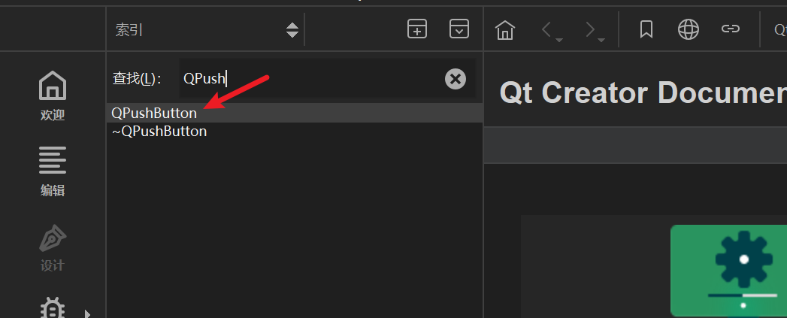
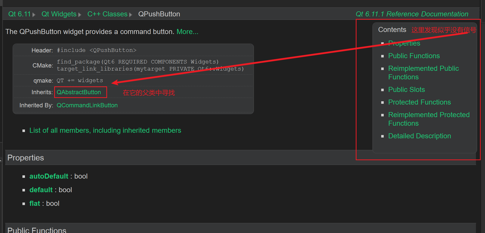
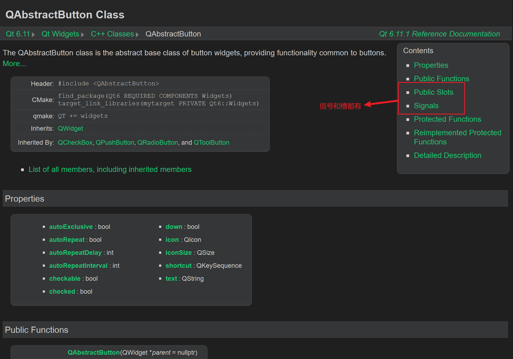

# 信号与槽

信号与槽是Qt最特别的机制之一，信号槽其实是观察者模式（发布-订阅模式）。当某一个**事件**发生后，比如按钮被点击了一下，就会发出一个信号，这种发出无目的，和网络中的广播类似。如果有对象对此信号有兴趣就会通过`connect`函数进行连接，将处理的信号和自己的一个函数（也就是**槽**(slot)）绑定来处理这个信号。这就是类似于观察者模式。

##  信号本质

信号通常是由于用户对窗口或控件进行某些操作，导致窗口或控件产生某个特定事件，这时Qt对应窗口类发出某个信号。以此对用户挑选作出反应。也就是所，**信号本质就是事件**。

在Qt中信号是通过什么形式呈现给使用者？
- 我们对哪个窗口进行操作，哪个窗口就能捕捉被触发的事件
- 对使用者来说触发一个事件可以得到Qt框架给我们发出的某个特定信号
- 信号呈现形式是函数，某个事件产生了，Qt框架就会调用某个对应的信号函数，通知使用者

##  槽本质

槽是一类特殊功能函数，也可以作为类的普通成员使用
称之为槽是因为它们还有一个职责：对Qt中产生的信号进行处理。槽函数的所有者也是某个类的实例对象。

## 信号与槽的关系

信号和槽函数都是独立的个体，本身没有任何联系。但由于某些特性需求我们可以将二者进行连接。

下面是`connect`函数的原型：
```cpp
QMetaObject::Connection QObject::connect(
    	const QObject *sender, PointerToMemberFunction signal, 
        const QObject *receiver, PointerToMemberFunction method, 
		Qt::ConnectionType type = Qt::AutoConnection);
参数:
  - sender:   发出信号的对象
  - signal:   属于sender对象, 信号是一个函数, 这个参数的类型是函数
              指针, 信号函数地址
  - receiver: 信号接收者
  - method:   属于receiver对象, 当检测到sender发出了signal信号, 
              receiver对象调用method方法，信号发出之后的处理动作
 
//  参数 signal 和 method 都是函数地址, 因此简化之后的 connect() 如下:
connect(const QObject *sender, &QObject::signal, 
        const QObject *receiver, &QObject::method);
```

> `connect`函数相当于对信号处理动作的注册
> 调用`connect`函数的`sender`对象信号并没有产生，因此`receiver`对象的`method`也不会被调用
> `method`槽函数本质为回调函数，调用时机为信号产生之后，调用由Qt框架执行
> `connect`中`sender`和`recever`两个指针必须被实例化，否则不会成功

# 标准信号槽使用

## 标准信号与槽

在Qt提供的很多标准类中都可以对用户触发的某些特定事件进行检测, 因此当用户做了这些操作之后, 事件被触发类的内部就会产生对应的信号, 这些信号都是Qt类内部自带的, 因此称之为**标准信号**。

同样，Qt许多类内部为我们提供了很多功能函数，并且这些函数也可以作为触发信号的处理动作，这些函数被成为**标准槽函数**

自带的信号与槽通过帮助文档进行查找。
举个例子：`QPushButton`
<!-- more -->








## 使用

```text
比如现在我们有一个功能：点击窗口上的按钮来关闭窗口

谁发出信号？ -> QPushButton类型
谁接收信号？ -> QWidget类型
```
发出的信号以及接收的槽函数分别是怎样的呢？
```cpp
// 单击按钮发出信号
[signal] void QAbstractButton::clicked(bool checked = false);

// 关闭窗口的槽函数
[slot] bool QWidget::close();
```

组合起来只需要一个`connect`函数：
```cpp
connect(ui->closeButton, &QPushButton::clicked, this, &MainWindow::close);
```

- `ui->closeButton`：谁发出的信号
- `&QPushButton::clicked`：发出的什么信号
- `this`： 谁来接收这个信号，`this`表示指向当前窗口的指针
- `&MainWindow::close`：接收这个信号怎么处理

#  自定义信号槽的使用

Qt框架提供的信号槽在某些特定场景下是无法满足我们的项目需求的，因此我们还设计自己需要的的信号和槽，同样还是使用connect()对自定义的信号槽进行连接。

如果想要在QT类中自定义信号槽, 需要满足一些条件, 并且有些事项也需要注意:

- 要编写新的类并且让其继承Qt的某些标准类
- 新的子类必须从QObject类或者是QObject子类进行派生
- 在定义类的头文件中加入 `Q_OBJECT` 宏

比如：
```cpp
// 在头文件进行派生类的时候，首先要引入Q_OBJECT宏
class MyMainWindow: public QWidget
{
	Q_OBJECT
	//接下来写的其他代码
};
```


##  自定义信号

由于信号本质是事件，并且在框架中也是以函数形式存在，而且信号对应的函数**只有声明没有定义**，所以有时候标准信号无法满足我们的需求，此时可以对信号进行自定义，当自定义信号的事件产生之后，将这个信号发射出去即可

需要注意一些东西：
- 信号是类的成员函数
- 返回值**必须**是`void`类型
- 信号名字可以根据情况指定
- 参数可以随意指定，信号支持重载
- 信号要用`signals`关键字声明，和`public`类似
- 信号函数只需要声明不用定义
- 发射信号的本质其实就是**调用信号函数**
- `emit`其实是表示这是一个信号函数，但可以省略不写
- `emit`只是显式声明信号要被发射，无其他含义
- `emit` == `#define emit`

举一个简单例子:
```cpp
// 信号槽机制必须从QObject类派生，直接或间接均可
class Person : public QObject
{
	Q_OBJECT
signals:
	void personSignal();
	void personSignal(int); //参数是数据传递，谁调用谁指定。实参会被传递给槽函数
};
```


##  自定义槽

和自定义信号相对应，而且也可以当普通成员函数使用
简单写一下注意事项：
- 返回值必须是`void`类型
- 槽也是函数，故而也支持重载
- 槽函数需要指定参数数量，这个看连接信号的参数个数
- 槽函数参数是用来接收信号传递数据，信号传递数据为信号参数，比如说：
	- 信号函数：void testsignal(int a, double b);
	- 槽函数：void testslot(int a,double b);
- 槽函数参数和对应信号函数参数一致，并且严格对齐
- 信号参数**可以大于等于槽函数的参数**，多于参数相当于是信号传递的参数被忽略

- 槽函数的声明用`slots`，比如
```cpp
class Person : public QObject
{
public:
	void personslot();
	static void personfunc();

public slots:
	void personslot(int)
};
```
上面三个函数都可以作为槽函数使用


#  信号槽使用的拓展部分
一个信号可以连接多个槽，发送一个信号可能有多个处理动作
但也需要写多个`connect`函数，而且执行顺序**随机**，和`connect`调用顺序无关，信号接收可以是一个或多个对象

一个槽也可以连接多个信号，多个不同信号有相同处理，不够也需要写多个`connect`函数

信号可以连接信号：信号接收者可以不处理接收信号而是继续发射信号，这样相当于传递了数据但并没有进行处理

信号槽可以断开：`disconnect`

## 