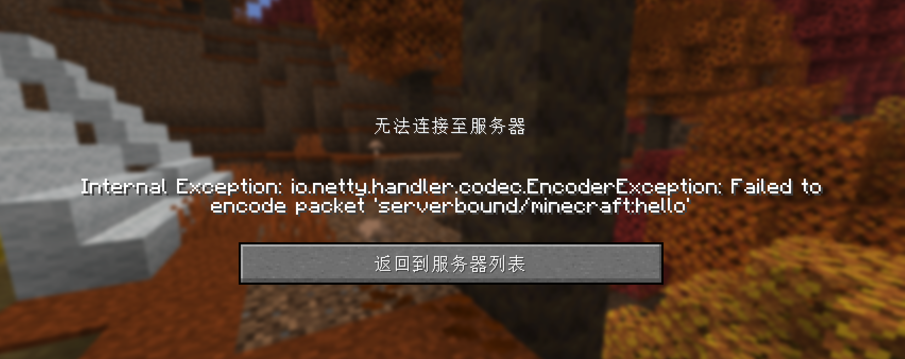

# mc无法创建世界

兴致冲冲下载了我的世界，结果无法创建世界呢...
<!-- more -->

## 现象
这是进服务器时登录包编码失败，客户端没能把登录包发出去，检查日志发现是：
`String too big (was 25 characters, max 16)`
也就是说当前游戏名有 25 个字符，`serverbound/minecraft:hello` 只允许 最多 16 个。名字一超长，本地服务器就会把连接掐掉，所以画面上显示「无法连接至服务器」。这和 Java 环境、服务器地址无关。在 HMCL 里把这个账号的名字改成 16 个字符以内，只使用英文字母、数字和下划线，然后重新进入世界就好了