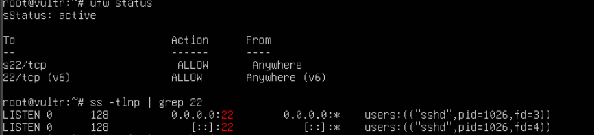
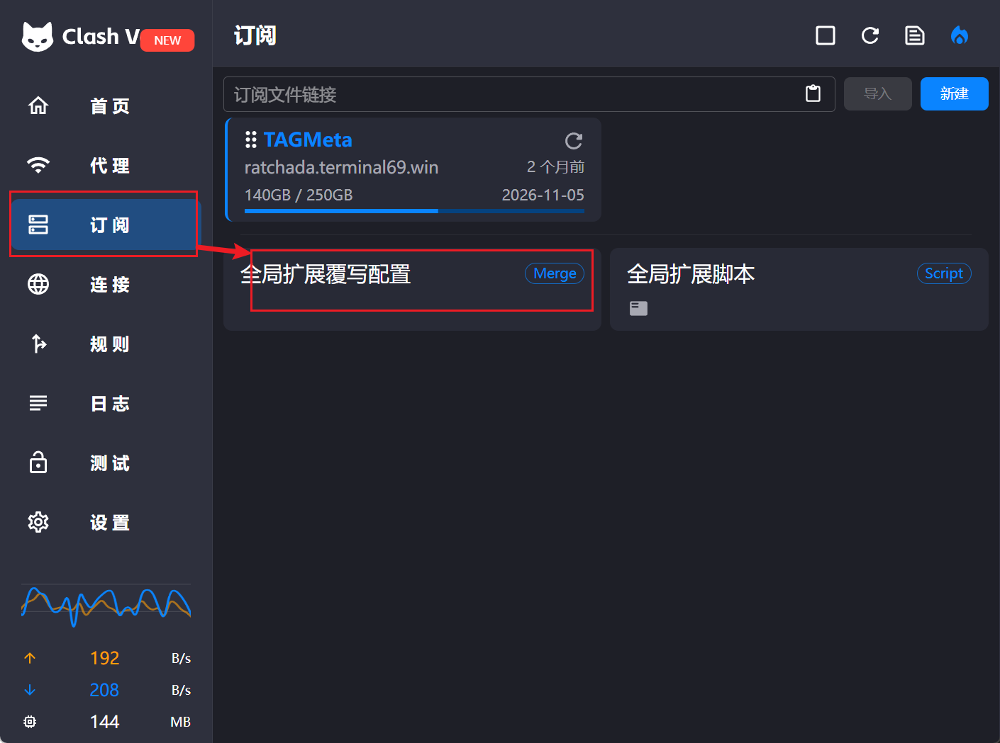
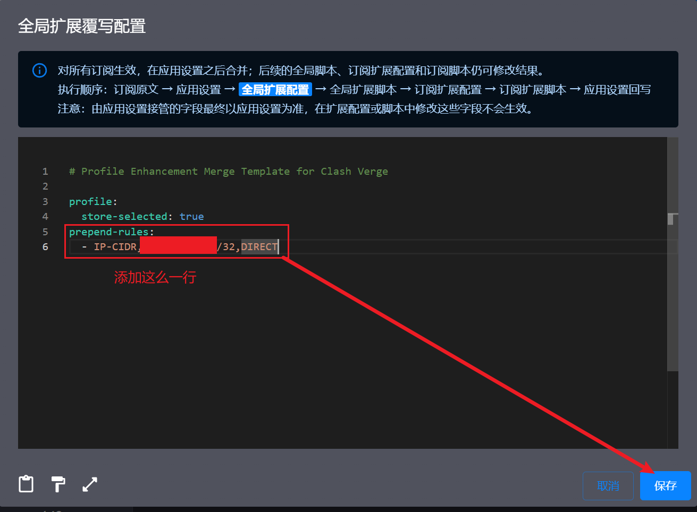
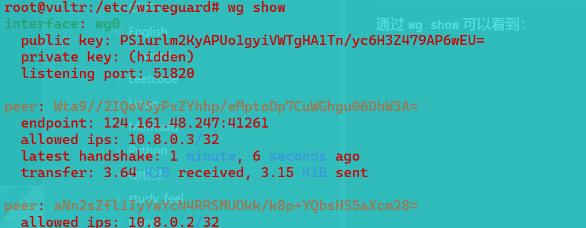

# 环境选择
使用Vultr，然后使用WireGuard来进行搭建

# 开始
## 一些问题和回答
###  `WireGuard` 用的是 TCP 还是 UDP？

`WireGuard` 用的是 UDP，隧道里跑的 TCP 自己会负责可靠传输，如果外面再套一层 TCP，丢包时里外两层会同时重传，速度会越来越慢，这叫"TCP 套 TCP"问题。所以 VPN 外层一般用 UDP，WireGuard 默认端口是 UDP 51820


### 客户端配置里写 `AllowedIPs = 10.8.0.0/24`，效果是什么？

`AllowedIPs` 有两个作用，一是发出去：目标地址在 `10.8.0.0/24` 里的流量走这条隧道，相当于加一条路由；二是收进来：只接受来源地址在这个网段里的包，相当于一道过滤


### 服务器上不开 `net.ipv4.ip_forward`，会出现什么现象？

服务器上不开 `ip_forward`，服务器只把发给自己的包收下，转给别人的包会直接丢掉，所以能够`ping`通服务器自己的`10.8.0.1`，但通过它访问外网就不通

## 选择VPS并创建

### 选择配置
CPU：由于是进行学习使用，所以选择 Shared CPU，最便宜这档，选 **vc2-1c-1gb**（每月 5 美元，每小时 0.007 美元）

地区：选择东京，离我比较近延迟较低

系统：Ubuntu 24.04 LTS x64

SSH Key：添加了自己的公钥，采用密钥登录，密钥位置存在`C:\Users\123\.ssh\id_ed25519.pub`
（公钥需要自己在创建实例前先添加好）

### 使用SSH测试是否能登录
```powershell
ssh root@ip
```
这里就不贴ip的敏感信息了

结果：
<!-- more -->


可以发现被对面断开了


### 登录VPS查看


可以发现sshd 是正常的：服务在运行，也在监听 `0.0.0.0:22`，最后那行 `Connection closed by 103.203.59.9 ... [preauth]` 很可能就是那次连接，说明连接到了服务器，但在握手前就断了

使用防火墙命令查看：
```bash
ufw status
ss -tlnp | grep 22
```



后面通过下面命令进行实时输出日志：
```bash
journalctl -u ssh -f
```

然后就发现..服务器这边都没问题：ufw 已经放行 22/tcp，sshd 也在 IPv4 和 IPv6 上监听，那是怎么回事？

经过检查发现是自己本地网络的问题。。。只好换个地区重新开始，步骤和前面一致，但是**还是不行**

### 修复网络问题
经过排查确认了是由于本地使用Clash的TUN模式，此时流量是先进Clash，再从机场节点出去，而很多机场节点**会屏蔽 22 端口（防止被拿去扫描或滥用）**，连上后直接掐断，那么此时就有两个解决方案了：
- 临时关闭TUN模式
- 在Clash里添加规则让访问服务器ip地址走直连
第一种方案用了发现会直接连接超时...只能使用另一种方案：



右键打开文件编辑：


其中`prepend-rules` 的意思是把这条规则插到所有规则的最前面，这样不管订阅里写了什么，访问这台服务器都走直连
，不过也不行...最后还是改掉了机子的22端口。


### 更换机子的22端口，采用其他端口
```bash
ufw allow 2222/tcp
# rm -rf /etc/systemd/system/ssh.socket.d 可选
systemctl daemon-reload
printf 'Port 22\nPort 2222\n' > /etc/ssh/sshd_config.d/10-port.conf
sshd -t && systemctl restart ssh
ss -tlnp | grep sshd
```
每一行的作用：

1. `ufw allow 2222/tcp`：在防火墙上放行 2222 端口。
2. `rm -rf .../ssh.socket.d` 和 `systemctl daemon-reload`：撤销失败的 socket 改法。
3. `printf ... > /etc/ssh/sshd_config.d/10-port.conf`：让 sshd 同时监听 22 和 2222。
4. `sshd -t && systemctl restart ssh`：先检查配置语法，没错误才重启 sshd。
5. `ss -tlnp | grep sshd`：确认两个端口都在监听。

### 如果也不行呢？
说明不是端口的问题，而是到这个 IP 的 SSH 流量整体被干扰了，只能重建
通过多次重建最终确认了是本地Clash的问题，更确切地说是机场的问题。


## 配置系统
SSH 只允许密钥登录、关掉密码登录，并只放行 22：
```bash
ufw allow OpenSSH
ufw --force enable
ufw status
sed -i 's/^#\?PasswordAuthentication.*/PasswordAuthentication no/' /etc/ssh/sshd_config
sshd -t && systemctl restart ssh
```

## 安装WireGuard
```bash
apt update && apt install -y wireguard

wg genkey | tee /etc/wireguard/server_private.key | wg pubkey > /etc/wireguard/server_public.key

wg genkey | tee /etc/wireguard/client_private.key | wg pubkey > /etc/wireguard/client_public.key

chmod 600 /etc/wireguard/*_private.key

cat /etc/wireguard/server_public.key /etc/wireguard/client_public.key
```

生成公钥后就可以：
```bash
NIC=$(ip route show default | awk '{print $5}')
cat > /etc/wireguard/wg0.conf <<EOF
[Interface]
Address = 10.8.0.1/24
ListenPort = 51820
PrivateKey = $(cat /etc/wireguard/server_private.key)
PostUp = iptables -t nat -A POSTROUTING -o $NIC -j MASQUERADE; iptables -A FORWARD -i wg0 -j ACCEPT; iptables -A FORWARD -o wg0 -j ACCEPT
PostDown = iptables -t nat -D POSTROUTING -o $NIC -j MASQUERADE; iptables -D FORWARD -i wg0 -j ACCEPT; iptables -D FORWARD -o wg0 -j ACCEPT

[Peer]
PublicKey = $(cat /etc/wireguard/client_public.key)
AllowedIPs = 10.8.0.2/32
EOF

chmod 600 /etc/wireguard/wg0.conf

echo 'net.ipv4.ip_forward=1' > /etc/sysctl.d/99-wg.conf && sysctl --system | grep ip_forward

ufw allow 51820/udp

systemctl enable --now wg-quick@wg0

wg show
```

每部分的作用：

1. `Address 10.8.0.1/24` 是服务器在隧道里的 IP，`ListenPort 51820` 是它监听的 UDP 端口。
2. `PostUp` 里的 `MASQUERADE` 就是 NAT：把客户端 10.8.0.2 发出去的包，源地址改成服务器的公网 IP 再发出去。
3. `[Peer]` 里的 `AllowedIPs = 10.8.0.2/32` 就是诊断时学到的两层意思：发往 10.8.0.2 的流量走这个对端，同时只接受这个对端发来的、源地址是 10.8.0.2 的包。
4. `ip_forward=1` 让内核允许在网卡之间转发数据包。

现在服务器端配置完毕：wg0 在监听 51820，对端公钥和 `10.8.0.2/32` 也对应，然后就需要生成客户端配置：
```bash
cat <<EOF
[Interface]
PrivateKey = $(cat /etc/wireguard/client_private.key)
Address = 10.8.0.2/24

[Peer]
PublicKey = $(cat /etc/wireguard/server_public.key)
Endpoint = 149.28.138.42:51820
AllowedIPs = 10.8.0.0/24
PersistentKeepalive = 25
EOF
```

另外再给手机建一个对端，用 `10.8.0.3`，再生成二维码：
```bash
apt install -y qrencode

cd /etc/wireguard

wg genkey | tee phone_private.key | wg pubkey > phone_public.key

chmod 600 phone_private.key

wg set wg0 peer $(cat phone_public.key) allowed-ips 10.8.0.3/32

wg-quick save wg0

cat > phone.conf <<EOF
[Interface]
PrivateKey = $(cat phone_private.key)
Address = 10.8.0.3/24
DNS = 1.1.1.1

[Peer]
PublicKey = $(cat server_public.key)
Endpoint = 149.28.138.42:51820
AllowedIPs = 10.8.0.0/24
PersistentKeepalive = 25
EOF

qrencode -t ansiutf8 < phone.conf
```
通过`wg show`可以看到：

成功

现在是`10.8.0.0/24`，所以只有发给隧道网段的包会走 VPN。改成 `0.0.0.0/0`（所有 IPv4 地址）后，手机访问任何网站，包都会先加密发到服务器，服务器再用 NAT 把源地址换成自己的公网 IP 发出去，回来的包原路返回.。

访问`ip.sb`，如果显示的是机子ip，说明全部流量都走隧道。
重新查看二维码：
```bash
qrencode -t ansiutf8 < /etc/wireguard/phone.conf
```

关于电脑端：
- 在电脑上装 [WireGuard for Windows](https://www.wireguard.com/install/)。
- 打开后点"新建隧道"（Add Tunnel 旁的下拉里选 Add empty tunnel），把上面输出的内容整段粘进去，命名为 `vultr` 保存，再点"连接"。
- 在 PowerShell 里跑 `ping 10.8.0.1`。
