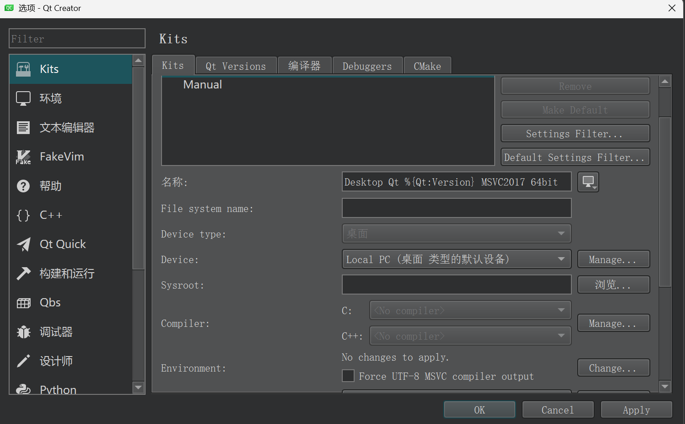
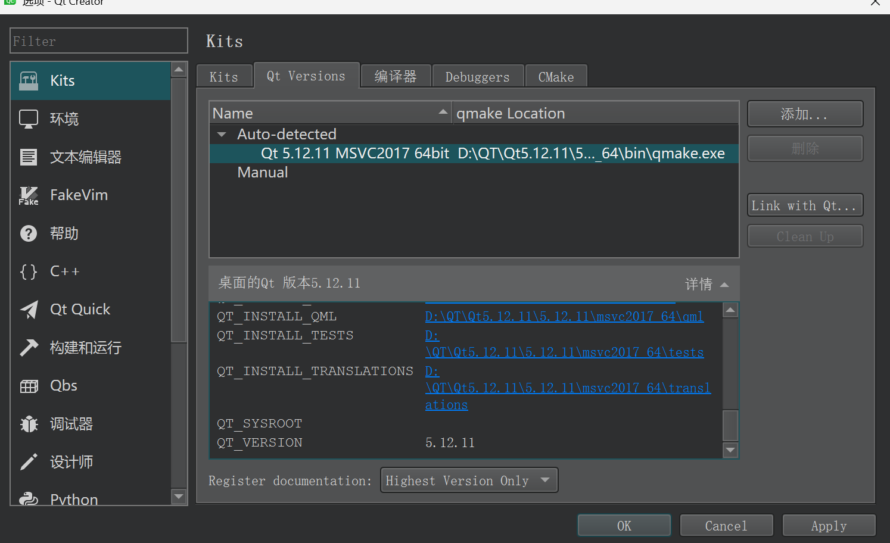

# QtCreator构建配置的问题

Qt Creator 4.15这个版本有问题：无法配置kit
<!-- more -->



原因在于：Qt Creator 4.15 只能认到 MSVC 2017（编译器 19.16）。它会把 VS 2022 的 17.14 误判成 MSVC 2005，所以自动检测永远配不上 Qt 5.12.11。

由于我的主机有19.16，路径是 `VC\Tools\MSVC\14.16.27023`，但 4.15 不会自己用它，要手动指定，所以每次从下面这个脚本启动。
脚本地址： `D:\QT\start-qtcreator-4.15.bat`
脚本内容：
```powershell
@echo off
call "D:\Program Files\Microsoft Visual Studio\2022\Community\VC\Auxiliary\Build\vcvars64.bat" -vcvars_ver=14.16
start "" "D:\QT\Qt5.12.11\Tools\QtCreator\bin\qtcreator.exe" -settingspath D:\QT\creator-4.15-settings
```
其中`-settingspath` 让 4.15 用单独的配置，避免和新版 Creator 互相覆盖。

打开后：


实现步骤：

1. 写了启动脚本 `D:\QT\start-qtcreator-4.15.bat`。它先启用 MSVC 19.16，再用单独的配置目录启动 4.15，避免和新版 Creator 互相覆盖。
2. 在这份独立配置里加了套件 Desktop Qt 5.12.11 MSVC2017 64bit：
    - Qt：`D:\QT\Qt5.12.11\5.12.11\msvc2017_64\bin\qmake.exe`
    - C / C++：`VC\Tools\MSVC\14.16.27023\bin\Hostx64\x64\cl.exe`
    - 构建工具：Qt Creator 自带的 `jom.exe`。4.15 会传 `-j`，`nmake` 不认这个参数。
3. 用这个脚本打开 HelloQt，选中该套件并执行构建。窗口右下角进度条变绿，生成了  
     `D:\QT\projects\dowith4.15\build-HelloQt-Desktop_Qt_5_12_11_MSVC2017_64bit_qt51211-Debug\debug\HelloQt.exe`。