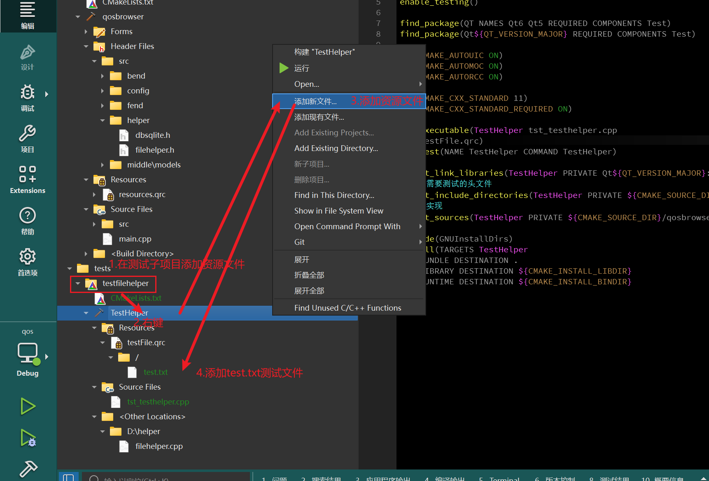

# 在QtCreator中如何添加需要的头文件？
## 告诉cmake
在要添加头文件的项目下面`CMakeLists.txt`中添加：
```cmake
# 告诉编译器去哪个目录找头文件
target_include_directories(TestHelper PRIVATE
    ${CMAKE_SOURCE_DIR}/qosbrowser/src
)

# 把 FileHelper(例子) 的实现也一起编译进测试程序
target_sources(TestHelper PRIVATE
    ${CMAKE_SOURCE_DIR}/qosbrowser/src/helper/filehelper.cpp
)
```
- `${CMAKE_SOURCE_DIR}`：就是最外层的 `qos` 文件夹（也就是项目的根目录）

## 在对应文件里面进行添加
使用头文件添加:
```cpp
#include "src/helper/filehlper.h"
```
即可

## 在把头文件添加进来了之后要如何进行测试？
### `QCOMPARE`
就是使用`QCOMPARE`来进行测试。它的语法为：`QCOMPARE(实际值, 期望值)`
两边相等就是 PASS，不相等就是 FAIL，并且会把两边的值都打印出来让我们对比

### 添加测试文件
本次进行测试的是`FileHelper::readAllText`:
```cpp
QVariant FileHelper::readAllJson(const QString &file_path)
{
    QString data = readAllText(file_path);
    //转化为json数据
    QJsonDocument doc = QJsonDocument::fromJson(data.toUtf8());
    return doc.toVariant();
}
```
在tests文件夹内的子项目`testfilehelper`中添加资源文件，并把测试文件`test.txt`加进去用来进行测试：
<!-- more -->


`test.txt`内容如下：
```text
这是泪叶丝用来进行测试部分的文件>w<
```
在默认添加的`tst_testhelper.cpp`中编写测试代码：
```cpp
void TestHelper::test_readAllText()
{
    QCOMPARE(FileHelper::readAllText(":/test.txt"), "这是泪叶丝用来进行测试部分的文件>w<");
}
```
