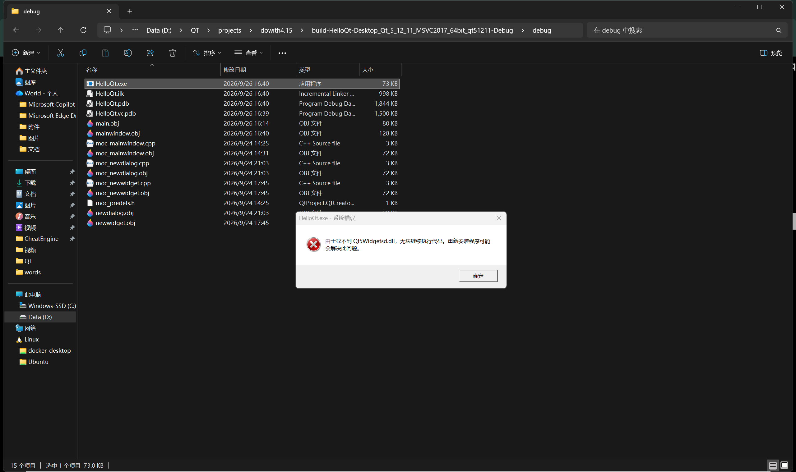

# Qt Creator外部无法运行exe程序

因为要调试程序，所以使用QDebug进行打印操作，想看看启动exe并查看console输出，结果发现报错：
<!-- more -->



原因为：**在 Qt Creator 外部双击运行可执行文件（`.exe`）时，系统默认不会自动加载 Qt 相关的动态链接库（DLL）以及依赖的插件**

## 解决

一般来说有几种解决方法

### 使用 Qt 官方打包工具 `windeployqt`

方便且标准。会自动帮你将 `.exe` 依赖的所有 Qt 动态库和插件复制到当前文件夹中，具体步骤为：
1. 打开 Qt 命令行工具：在 Windows 开始菜单中寻找安装的 Qt 文件夹（例如 `Qt 5.12.11 (MSVC 2017 64-bit)` 对应的命令行终端，即 **Qt 5.12.11 64-bit for Desktop (MSVC 2017)**）

>需要注意的是一定要选择和**构建编译环境一样**的命令行


2. 进入`.exe`所在目录：
```powershell
cd /d "D:\QT\projects\dowith4.15\build-HelloQt-Desktop_Qt_5_12_11_MSVC2017_64bit_qt51211-Debug\debug"
```


3. 运行打包命令：
```powershell
windeployqt HelloQt.exe
```

### 将编译器的 `bin` 目录添加到系统环境变量

这是为了以后在任何位置都能直接运行编译出来的程序：
- 找到当前构建所对应 Qt 编译器的 `bin` 目录，例如：    
`D:\QT\5.12.11\msvc2017_64\bin` （根据具体安装路径调整）。
    
- 将此路径添加到 Windows 的 **系统环境变量 `Path`** 中。
    
- 添加完成后重启系统或重新打开文件夹，即可直接双击运行。

这里因为是安装了两种Qt版本所以没有采取将后面的Qt5加入带系统环境变量，为了防止冲突。