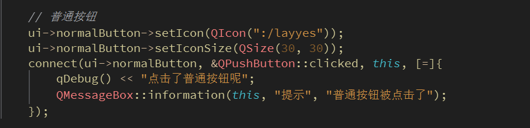

#  问题
在进行按钮学习中，设置了图标，但运行程序后发现无法被正确显示：
<!-- more -->


运行：


#  排查解决
经过检查，路径正确，那么问题就是：**`.qrc` 文件没有被 RCC 编译进程序**
修复：
在 CMakeLists.txt:6 中、`qt_add_executable()` 之前添加：

```cmake
qt_standard_project_setup()

set(CMAKE_AUTORCC ON)

qt_add_executable(Button
```

然后在 Qt Creator 中重新运行 CMake并重新构建