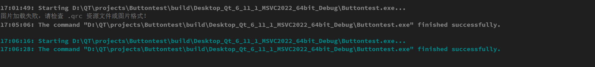

#  问题
在进行容器学习过程中遇到图片无法正常显示的问题，代码如下：
```cpp
QLabel* label = new QLabel;
label->setPixmap(QPixmap(":/1.png"));
ui->scrollArea->setWidget(label);
```
当然省略了其他必要代码，运行发现没有图片，排查了图片的路径问题...那么是什么问题？通过这个进行排查：
```cpp
QLabel* label = new QLabel(ui->scrollArea);
QPixmap pixmap(":/1.png");
if (pixmap.isNull()) {
    qDebug() << "图片加载失败，请检查 .qrc 资源文件或图片格式！";
} else {
    label->setPixmap(pixmap);
    label->setScaledContents(true); // 允许图片自适应 Label 大小
}

ui->scrollArea->setWidget(label);
```
运行发现终端输出了以下内容：
<!-- more -->



说明`pixmap`里面确实是空的，图片没被正确读取，但路径又没问题，这是怎么回事？

# 解决
经过搜索已经排查发现：**项目使用的是 CMake**。而在 **CMake** 项目中，仅仅把 `.qrc` 文件拖进项目目录是不够的，**CMake 默认不会自动去编译 `.qrc` 资源文件**，除非在 `CMakeLists.txt` 中显式配置了资源文件，所以只需要在`CMakeLists.txt`加上这么一行即可：
```cmake
set(CMAKE_AUTORCC ON)
```
虽然Qt也会自动加上`.qrc`文件，但保险起见检查一下是否有以下的代码：
```cmake
add_executable(Buttontest
    main.cpp
    button.cpp
    button.h
    button.ui
    imgs.qrc   # <--- 必须加上这一行
)
```

再次运行，成功显示。


# Qt中单例模式的应用
单例模式（Singleton Pattern）是一种非常常见的设计模式，用于确保一个类**在全局范围内只有一个实例**，并提供一个全局访问点

## 实现的三种方式
###  C++11标准的 Meyers' Singleton（经典局部静态变量法）
```cpp
class ConfigManager {
public:
    static ConfigManager& instance() {
        static ConfigManager config; // 线程安全，首次调用时初始化
        return config;
    }

    // 删除拷贝构造和赋值操作符
    ConfigManager(const ConfigManager&) = delete;
    ConfigManager& operator=(const ConfigManager&) = delete;

private:
    ConfigManager() = default;
    ~ConfigManager() = default;
};
```

###  Qt官方推荐`Q_GLOBAL_STATIC`宏
Qt 提供了一个专门用于管理全局静态/单例对象的宏
- **优势**：它是线程安全的，支持**懒加载**（第一次使用时才创建），并且能很好地处理复杂的析构顺序，避免多线程环境下的崩溃。
- **注意**：该宏必须写在 `.cpp` 文件中（不能写在头文件中），否则在多源文件中会产生多份实例。

###  Qt 6.3+ 引入的 `Q_APPLICATION_STATIC`
如果单例生命周期需要**严格绑定到 `QCoreApplication`**（即在应用退出前、`QCoreApplication` 销毁时自动安全释放），可以使用 Qt 6.3 引入的 `Q_APPLICATION_STATIC` 宏。


# `QStandardItemModel`类
这是Qt Model/View架构的核心，通用的数据模型类

## 用途
- **配合视图使用**：它通常与 `QTableView`、`QListView` 或 `QTreeView` 等界面组件绑定，实现数据显示与业务逻辑的分离
- **基于项（Item-based）存储**：它使用 `QStandardItem` 对象来管理具体的数据、图标、文本和状态
- **支持树形/表格结构**：既可以用来构建简单的二维表格，也可以用来构建复杂的树形层级目录
- **开发便利**：不需要像自定义模型那样去继承 `QAbstractItemModel` 并重写繁琐的虚函数，直接实例化该类就可以像操作容器一样自由增删改查数据

# 关于遇到的陌生函数
`horizontalHeader()`
- 来源类：`QTabView`
- 获取表格顶部的水平表头对象
- 单词：`horizontal`（水平的）+ `Header`（表头）
- 作用：控制所有“列”的整体外观和尺寸行为（比如列宽调整方式、表头显示隐藏等）

`setStretchLastSection(true)`
- 来源类：`QHeaderView`
- 含义：设置表格最后一列自动拉伸铺满
- 单词：`set`（设置）+ `Stretch`（伸展/拉伸）+ `Last`（最后的）+ `Section`（分段/列）
- 作用：开启后让表格的最后一列自动延伸，正好填满表格右侧剩余的空白区域，防止出现空白缺块

`verticalHeader()`
- **来源类**：`QTableView`
- **含义**：获取表格左侧的垂直表头对象
- **单词**：`vertical`（垂直的）+ `Header`（表头）
- **作用**：控制所有“行”的表头属性（比如行号显示、行高调整方式等）

`setHidden(true)`
- **来源类**：`QWidget`（`QHeaderView` 继承自 `QWidget`）
- **含义**：设置控件是否隐藏
- **单词**：`set`（设置）+ `Hidden`（隐藏的）
- **作用**：将垂直表头隐藏起来，隐藏后表格最左侧默认显示的行号（如 1、2、3...）就会消失，让界面看起来更加简洁