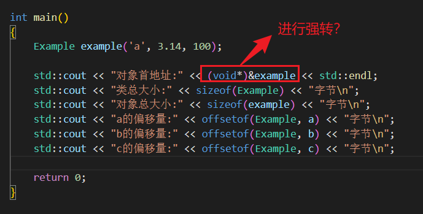

# 打印对象地址为什么需要强转换

<!-- more -->



疑问如图所示

严格来说，对于 `Example*` 类型的指针 `&ex`，在 `std::cout` 中 **即使不加 `(void*)` 强制转换，也能正常输出十六进制地址**。因为 C++ 的 `std::cout` 对普通对象指针有默认的隐式转换规则（会自动转换为 `const void*` 并按地址输出）。


在这里加上 `(void*)` 强制类型转换，主要出于以下几个核心原因：

1. 规避 `char*` 被误当成 C 风格字符串打印（最核心的原因）


这是 C++ 中使用 `std::cout` 打印地址时最容易踩的坑：

- `std::cout` 对 `char*` 或 `const char*` 重载了 `operator<<`，要求将其作为**以 `\0` 结尾的 C 风格字符串**逐字符输出，而不是输出内存地址。
    
- 如果试图打印 `a` 成员的地址 `std::cout << &ex.a;`，因为 `&ex.a` 的类型是 `char*`，`std::cout` 会试图从这个地址开始一直往后读取字符直到遇到 `\0` 为止。这会导致输出乱码，甚至因越界访问触发段错误（Segmentation Fault / 崩溃）。
    
- 因此，在 C++ 中打印任何字符型指针（或 `uint8_t*`）的地址时，**必须**强制转换为 `(void*)`：
```cpp
std::cout << (void*)&ex.a; // 正确：打印字符 a 的内存地址
```
为了保持代码一致性、防止未来修改变量类型时踩坑，习惯性地在用 `std::cout` 输出**任何**变量的地址时都加上 `(void*)`


2. 明确调用 `operator<<(const void*)` 重载

`std::cout` 内部定义了专门接收指针的重载函数：
```cpp
std::ostream& operator<<(const void* val);
```

该重载的作用就是将指针变量的值以十六进制形式（如 `0x7ff7bfe0b480`）输出。 当把指针显式转换为 `void*` 时，编译器会直接绑定到这个重载，消除任何由于类型隐式转换可能带来的多义性或重载匹配优先级的干扰。


3. 代码意图表达（Readability & Intent）

在 C/C++ 内存管理和底层开发中，`void*` 代表**不关注具体数据类型的无类型原始内存地址**。 写成 `(void*)&ex` 明确向阅读代码的人表达了你的意图：**“我现在只是想获取并显示这段内存的物理/虚拟起始地址，而不关注它指向的 `Example` 结构体本身。”**